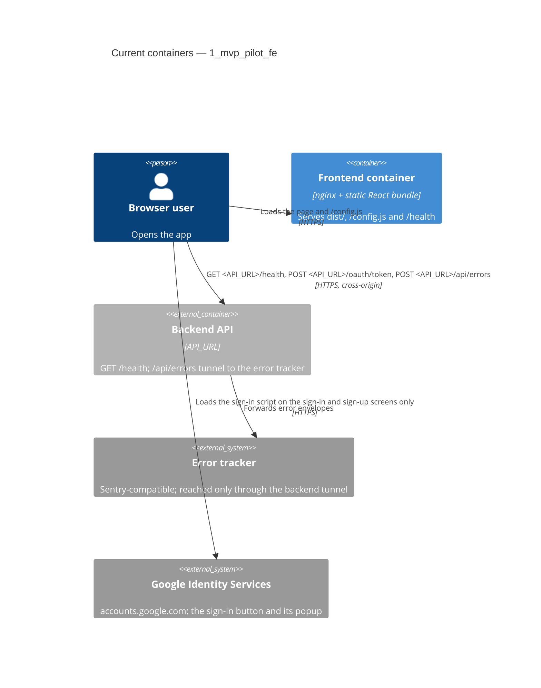

# Architecture map — 1_mvp_pilot_fe

> The **current** architecture (what exists today), produced by `map-architecture` and read by
> write-prd / architecture-design / generate-data-model / implement-tasks. Refresh with
> `/sdlc-map-architecture` when the repo drifts past `reflects_commit`. This is generated; a
> hand-maintained `docs/architecture.md`, if present, is authoritative and reconciled below — not
> replaced.

## Stack

- Language / runtime: TypeScript ~5.6 in the browser; Node.js 24 for the build and tests (`.nvmrc`).
- Frameworks: React 18, Vite 6, `@sentry/react` for error reporting, `react-router` 7 for client-side routing
  (`package.json`). No state or data-fetching library.
- Build / test / lint: `npm run build` (`tsc -b && vite build`, `package.json:8`), `npm test` (Vitest over
  `src/**/*.test.{ts,tsx}` and `tests/**/*.test.ts`, `vite.config.ts:10`), `npm run lint` (ESLint),
  `npm run typecheck` (`tsc -b`). The full CI list is in `CLAUDE.md` §Commands.
- Runtime: one nginx image serving `dist/` (`Dockerfile:9`), deployed with Kamal 2 to dev and promoted unchanged
  to prod (`deploy/promote.sh:15`).

## C4 — system as it is

## Module inventory

| Module | Path | Layers | Wired at | Responsibility |
|---|---|---|---|---|
| Entry point | `src/main.tsx` | app | `src/main.tsx:12` | Reads the runtime config, starts Sentry, triggers an error test, mounts `App` inside the error boundary |
| App shell | `src/App.tsx` | ui | `src/main.tsx:21` | Router with the route table; on dev only (`ENV_NAME` `dev`), a debug footer with the config summary and the API status from `fetchApiStatus` |
| Landing screen | `src/routes/Landing.tsx` | ui | `src/App.tsx:60` | Always dark (`.palette-landing`, ADR-0005): header with the brand and a sign-in link; a hero that explains the app, links to both starts (`/sign-in`, `/sign-up`) and shows a decorative dashboard preview hidden from assistive technology; feature cards, "How it works" steps, a final call-to-action card and the footer; also every unknown path |
| Sign-up screen | `src/routes/SignUp.tsx` | ui | `src/App.tsx:61` | In `AuthLayout`: Google's button (`google` slot), then email, password and confirmation; per-field errors, a taken email points to sign-in; stores the pair and opens `/dashboard` |
| Sign-in screen | `src/routes/SignIn.tsx` | ui | `src/App.tsx:71` | In `AuthLayout`: Google's button (`google` slot), then the email and password grant; one message for a wrong email or password, a wait message on `429`; stores the pair and opens `/dashboard` |
| Google sign-in | `src/auth/GoogleSignIn.tsx`, `src/auth/google.ts` | ui, infra | `src/App.tsx:61` | Loads Google's script on these screens only and removes its element and `window.google` when they close, exchanges the ID token at `/oauth/token`, stores the pair and opens the dashboard; says when Google sign-in did not complete |
| Legal pages | `src/routes/Legal.tsx` | ui | `src/App.tsx:86` | `Privacy` (`/privacy`) and `Terms` (`/terms`): public policy text in the landing's header and footer, with the contact line from `SUPPORT_EMAIL` or, when it is empty, "contact the operator of this deployment" |
| Site header and footer | `src/routes/SiteChrome.tsx` | ui | `src/routes/Landing.tsx:4` | `SiteHeader` (brand and sign-in link) on the landing and legal pages; `SiteFooter`, a `Legal` nav with the privacy and terms links, on the landing, legal, sign-in and sign-up pages |
| Auth layout | `src/routes/AuthLayout.tsx` | ui | `src/routes/SignUp.tsx:66` | Sign-up and sign-in shell: the brand at the top left, a decorative wave, one centred card with the link to the other screen in its head, the optional Google button and "or with email" divider, the way back and the legal footer |
| Brand mark | `src/routes/BrandMark.tsx` | ui | `src/routes/SiteChrome.tsx:12` | The one logo (`svg.brand-mark`, `aria-hidden`) beside "Pilot App" on the landing, legal, sign-up, sign-in, cabinet and crash screens (AC-15) |
| Text field | `src/routes/TextField.tsx` | ui | `src/routes/SignUp.tsx:7` | Label, input and its field error (`aria-invalid`, `aria-describedby`) for the auth and project forms |
| Dashboard screen | `src/routes/Dashboard.tsx` | ui | `src/App.tsx:82` | Sends a device without tokens to sign-in; a 280 px sidebar (a drawer below 768 px) with the project navigation, a 64 px top bar with the search; a filter card (status chips, a select on small screens), project cards with a head (name, Rename, Delete) and task rows with status chips; the `n` and `/` shortcuts; state cards with drawn illustrations for loading (static ring and placeholders), empty, first task, no match and load failure; create, rename and delete; adds tasks and changes a task's status in one click; signs this device out |
| Project form | `src/routes/ProjectForm.tsx` | ui | `src/routes/Dashboard.tsx:10` | Name and description for project create and rename and for task create; field errors before any request or from a `422` |
| Route paths | `src/routes/paths.ts` | ui | `src/App.tsx:12` | The one owner of the path strings used by the route table and the links (`/`, `/dashboard`, `/sign-in`, `/sign-up`, `/privacy`, `/terms`) |
| Error fallback | `src/ErrorFallback.tsx` | ui | `src/main.tsx:22` | The crash screen, shown by the error boundary outside the router: the brand (not a link), a decorative illustration and the message, saying whether the error was reported |
| Runtime config | `src/config.ts` | infra | `src/config.ts:19` | `readConfig` turns `window.APP_CONFIG` into a complete `AppConfig` with defaults |
| Error reporting | `src/sentry.ts` | infra | `src/main.tsx:13` | `initSentry`: off without a DSN, tunnel through the backend |
| Error test | `src/errorTest.ts` | app | `src/main.tsx:15` | `?error-test=<kind>&marker=<id>` deliberate errors for end-to-end checks |
| Config writer | `docker/40-config-js.sh` | infra | `Dockerfile:11` | Writes `/config.js` from the container environment at start, rejecting unsafe characters |
| Web server | `nginx.conf` | infra | `Dockerfile:10` | Static files, SPA fallback, `/config.js` uncached, `/health`, Content-Security-Policy on HTML; installed as a template that fills in `API_URL` |
| API client | `src/api/client.ts` | infra | `src/routes/Dashboard.tsx:28` | `createApiClient`: bearer token, one shared refresh on a 401, sign-out on a refused refresh |
| Credentials | `src/auth/credentials.ts` | app | `src/routes/SignUp.tsx:3` | `validateSignUp`, `signUp` (`createUser` through `postJson`) and `signIn` (`createToken`, password grant through `requestToken`), mapped to a result per contract answer; `signOut` (`signOut`) through the API client |
| Projects API | `src/api/projects.ts` | app | `src/routes/Dashboard.tsx:5` | `validateProject`, `listProjects`, `saveProject` (`createProject`, `updateProject`), `deleteProject`, `validateTask`, `createTask` (`createTask`) and `changeTaskStatus` (`updateTask`) through the API client, mapped to a result per contract answer |
| Token store | `src/auth/tokenStore.ts` | infra | `src/App.tsx:38` | `createTokenStore`: the token pair in localStorage, never throws; a pair storage refuses lasts for the page |
| Deploy (ops) | `deploy/`, `config/deploy*.yml`, `.github/workflows/` | ops | `deploy/lib.sh:36` | Kamal deploy, rollback, promotion and guards; not part of the bundle |

## Conventions (cited — the rules a new feature must match)

- **Module wiring / registration:** explicit imports from `src/main.tsx`; configuration is passed down as props
  (`config`), never read from globals inside components — `src/main.tsx:21`
- **Error handling:** network failures become a displayed state (`unreachable`), uncaught errors go to the Sentry
  error boundary — `src/App.tsx:30`, `src/main.tsx:20`
- **IDs:** none (no entities in the frontend).
- **Persistence / DB access:** none.
- **Migrations:** none.
- **Tests:** Vitest with Testing Library in jsdom, `fetch` stubbed with `vi.stubGlobal`, next to the module
  (`src/App.test.tsx:17`); shell scripts and workflows tested from `tests/` with fake commands on `PATH`
  (`tests/support.ts:27`).
- **Inter-module communication:** direct calls and props; HTTP only to the backend via `fetch` — `src/App.tsx:25`
- **UI / styling:** no component library; design values in `src/styles/tokens.css`, shared shell and controls in
  `src/styles/base.css`, plain global CSS per screen; every stylesheet is scanned for raw values — `src/main.tsx:6`,
  `tests/stylesheets.test.ts` (detail in §Frontend / UI foundation below)

## Datastores

| Store | Engine | Accessed via | Notes |
|---|---|---|---|
| localStorage `pilot.tokens` | browser | `src/auth/tokenStore.ts` | The token pair, written after sign-up or sign-in (ADR-0006) |

## Frontend / UI foundation

Boundaries pending operator confirmation (C3 after-merge gate).

- **Component library / design system:** no third-party library; an in-repo design system from the `redesign`
  feature (ADR-0001 … ADR-0006 under `docs/features/redesign/adr/`): one token layer, one base stylesheet, one brand
  mark and a stylesheet guard. The screens are under `src/routes/` (`Landing`, `SignUp`, `SignIn`, `Dashboard`,
  `Privacy` and `Terms`) plus the crash screen `ErrorFallback` (`src/ErrorFallback.tsx`) and the internal
  `RenderErrorTest` (`src/App.tsx`).
- **Design tokens:** CSS custom properties on `:root` in `src/styles/tokens.css` (ADR-0001): one set of semantic
  role names (colours including the status and soft colours, gradients, type families, weights and sizes, spacing,
  radii, shadows, motion, focus colour, `--content-width-max: 1200px`, `--sidebar-width`, `--topbar-height`), with a
  dark set under `@media (prefers-color-scheme: dark)`, so sign-up, sign-in, the cabinet and the crash screen follow
  the device theme (light with no preference); there is no toggle. The landing palette is the `.palette-landing`
  block in the same file (ADR-0005, `src/styles/tokens.css:110`): it overrides the same role names with an always-dark
  violet set and is set on the landing and legal roots (`src/routes/Legal.tsx:14`). Custom properties are defined
  only on `:root` and `.palette-landing` (`tests/design-tokens.test.ts`, which also checks the contrast of every
  colour pair in both themes).
- **Fonts:** self-hosted, never from a third-party origin (ADR-0006): Public Sans for body text
  (`@fontsource-variable/public-sans`, `--font-family-base`) and Space Grotesk for display text
  (`@fontsource-variable/space-grotesk`, `--font-family-display`), both imported first in `src/main.tsx:4`.
- **Styling approach:** plain global CSS imported by the module that uses it (ADR-0004): `src/styles/base.css`
  (imported right after the tokens, `src/main.tsx:7`; the page shell `.page` centred up to the content width, the
  header and `.brand`/`.brand-mark`, the buttons `.button`, `-primary`, `-outline`, `-text`, `-sm`, `-block`, `.link`,
  `.input`, `.alert` with `-error` and `-info`, the crash screen `.crash-*`, and the one `:focus-visible` ring);
  per screen `src/App.css`, `src/routes/Landing.css`, `src/routes/SiteChrome.css`, `src/routes/Legal.css`,
  `src/routes/AuthForm.css` (the auth layout and the forms) and `src/routes/Dashboard.css` (the sidebar, top bar,
  cards, chips and states). Motion is declared only inside `@media (prefers-reduced-motion: no-preference)`.
  No CSS modules, Tailwind or CSS-in-JS.
- **Stylesheet guard:** `tests/stylesheets.test.ts` with `tests/stylesheetScan.ts` (ADR-0002) scans every `.css`
  file under `src/` except `tokens.css` for raw colours, raw lengths in font-size, margin, padding, gap, inset,
  radius and shadows, and motion outside reduced motion; a stylesheet the app imports cannot escape it. The
  end-to-end sweep `e2e/redesign-sweep.spec.ts` checks the one brand mark, widths at 360, 768 and 1440 px, theme,
  focus, reduced motion and no third-party font or image on every screen.
- **Shared primitives:** `BrandMark` (`src/routes/BrandMark.tsx`), `AuthLayout` (`src/routes/AuthLayout.tsx`),
  `TextField` (`src/routes/TextField.tsx`), `ProjectForm` (`src/routes/ProjectForm.tsx`), `StatusIcon`
  (`src/routes/Brand.tsx`), `SiteHeader` and `SiteFooter` (`src/routes/SiteChrome.tsx`), and the Google sign-in
  button `GoogleSignIn` (`src/auth/GoogleSignIn.tsx`).
- **Runtime `/config.js`:** `index.html:9` loads `/config.js` before the bundle. At container start
  `docker/40-config-js.sh:64` writes `window.APP_CONFIG` from `API_URL`, `SENTRY_DSN`, `GOOGLE_CLIENT_ID`,
  `OAUTH_CLIENT_ID`, `SUPPORT_EMAIL`, `ENV_NAME` and `KAMAL_VERSION` (as `APP_VERSION`), after rejecting characters outside the URL
  set. `SENTRY_DSN` is served moved onto the `API_URL` origin (same key and project; events go through the
  backend tunnel), and a private host stops the container. `src/config.ts:19` (`readConfig`) applies defaults. nginx serves it with `no-store` (`nginx.conf:28`).
  Locally, the gitignored `public/config.js` plays its part. No environment value is compiled into the bundle
  (`scripts/check-bundle-config.sh` in CI).
- **Routing:** `react-router` 7 `BrowserRouter` in `src/App.tsx`, screens in `src/routes/`. `/` and every unknown
  path render `Landing`; `/sign-in` and `/sign-up` render `SignIn` and `SignUp`; `/dashboard` renders `Dashboard`;
  `/privacy` and `/terms` render `Privacy` and `Terms` (`src/routes/Legal.tsx`), public like the landing.
  Paths come from `src/routes/paths.ts`, never string literals. nginx falls back to `index.html` (`nginx.conf:14`)
  for every path.
- **API client:** `createApiClient` (`src/api/client.ts`) sends the access token from `createTokenStore`
  (`src/auth/tokenStore.ts`), refreshes it once on a 401 (one refresh shared by concurrent requests), repeats the
  request, and on a refused refresh (`400`; a `401` "Unknown client" keeps the tokens) clears the tokens and calls `onSignedOut`
  unless another tab already saved a newer pair; its `clientId` is `OAUTH_CLIENT_ID`.
  The dashboard uses it through `src/api/projects.ts`; sign-up and sign-in are unauthenticated and live in
  `src/auth/credentials.ts`, which saves nothing: the screens save the pair in the store `App` owns. `refresh()`,
  `signIn` and `exchangeGoogleIdToken` (`src/auth/google.ts`) send their grant through `requestToken`, typed by the
  contract's `TokenRequest`; the token endpoint takes no bearer token. `fetchApiStatus` (`src/App.tsx:23`) calls
  `fetch` on `<API_URL>/health`, cancelled by an `AbortController` in `useEffect` (`src/App.tsx:40`). Errors reach the tracker only through the backend tunnel
  `tunnel: <API_URL>/api/errors` (`src/sentry.ts:11`).
- **State / data-fetching:** React `useState` / `useEffect` only; no store or server-cache library —
  `src/App.tsx:37`
- **Closest UI precedent:** a new public page looks like `Landing` (`src/routes/Landing.tsx:74`), a signed-in screen
  like `Dashboard`, a form screen like `SignIn` in `AuthLayout`; each has its test next to it (Testing Library in a
  `MemoryRouter`, stubbed `fetch`) and an e2e spec under `e2e/` using the helpers in `e2e/support/`.

## Where things live / closest precedents

- A new screen → `src/routes/<Name>.tsx` with `src/routes/<Name>.test.tsx`, modelled on `Landing`
  (`src/routes/Landing.tsx:74`, `src/routes/Landing.test.tsx`), its path in `src/routes/paths.ts` and its
  `<Route>` in `src/App.tsx:60`; its styles use only `var(--…)` design values and the `base.css` controls.
- A new runtime setting → a field in `AppConfig` (`src/config.ts:1`), written by `docker/40-config-js.sh:64` and
  passed to the container by Kamal (`config/deploy.yml:22`).
- A new backend call → a function like `fetchApiStatus` (`src/App.tsx:23`) against `<API_URL>`, only for
  operations in the synced `contracts/`.
- A new deploy or CI script → `deploy/` or `scripts/`, with a `tests/*.test.ts` that runs it with fake commands
  (`tests/support.ts:27`).

## Constraints & known tech-debt

- Build once: one image per commit, deployed to dev and promoted unchanged to prod (`deploy/promote.sh:15`) — new
  work must not need a per-environment build.
- No environment values in the bundle: hosts, DSNs and the environment name come only from `/config.js`
  (`CLAUDE.md` Hard Rules; `scripts/check-bundle-config.sh src dist` in CI).
- The specs under `docs/features/<slug>/` are read-only `sync-spec` copies of the backend's (for example
  `docs/features/redesign/`).
- The TDD commit order is enforced on every pull request that changes code (`tdd-check`, `scripts/tdd-check.sh`), except the release PR develop → main; commits already on main are skipped.
- New UI reuses the design system above: a raw colour, size, spacing, radius or shadow in any stylesheet under `src/`
  fails `npm test`.

## Reconciliation with the authored architecture doc

No authored architecture doc; this map is the current reference. The README sections "Runtime config", "Error
reporting" and "Deploy" are the operational reference and agree with this map.
