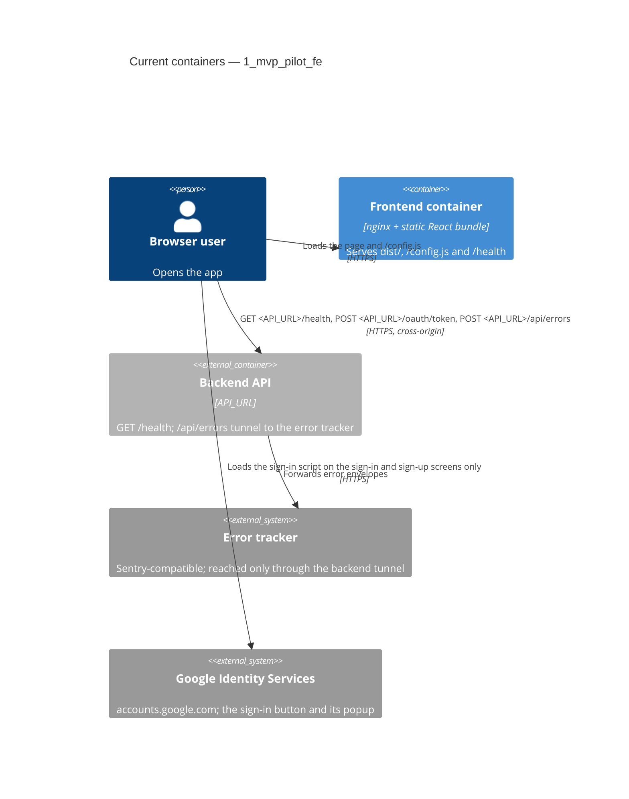

# Architecture map — 1_mvp_pilot_fe

> The **current** architecture (what exists today), produced by `map-architecture` and read by
> write-prd / architecture-design / generate-data-model / implement-tasks. Refresh with
> `/sdlc-map-architecture` when the repo drifts past `reflects_commit`. This is generated; a
> hand-maintained `docs/architecture.md`, if present, is authoritative and reconciled below — not
> replaced.

## Stack

- Language / runtime: TypeScript ~5.6 in the browser; Node.js 24 for the build and tests (`.nvmrc`).
- Frameworks: React 18, Vite 6, `@sentry/react` for error reporting, `react-router` 7 for client-side routing
  (`package.json`). No state or data-fetching library.
- Build / test / lint: `npm run build` (`tsc -b && vite build`, `package.json:8`), `npm test` (Vitest over
  `src/**/*.test.{ts,tsx}` and `tests/**/*.test.ts`, `vite.config.ts:10`), `npm run lint` (ESLint),
  `npm run typecheck` (`tsc -b`). The full CI list is in `CLAUDE.md` §Commands.
- Runtime: one nginx image serving `dist/` (`Dockerfile:9`), deployed with Kamal 2 to dev and promoted unchanged
  to prod (`deploy/promote.sh:15`).

## C4 — system as it is

## Module inventory

| Module | Path | Layers | Wired at | Responsibility |
|---|---|---|---|---|
| Entry point | `src/main.tsx` | app | `src/main.tsx:12` | Reads the runtime config, starts Sentry, triggers an error test, mounts `App` inside the error boundary |
| App shell | `src/App.tsx` | ui | `src/main.tsx:21` | Router with the route table; on dev only (`ENV_NAME` `dev`), a debug footer with the config summary and the API status from `fetchApiStatus` |
| Landing screen | `src/routes/Landing.tsx` | ui | `src/App.tsx:53` | Header with the brand and a sign-in link; a hero that explains the app, links to both starts (`/sign-in`, `/sign-up`) and shows a static dashboard preview hidden from assistive technology; four feature cards; a final call to action; also every unknown path |
| Sign-up screen | `src/routes/SignUp.tsx` | ui | `src/App.tsx:54` | Google's button (`google` slot), then email, password and confirmation; per-field errors, a taken email points to sign-in; stores the pair and opens `/dashboard` |
| Sign-in screen | `src/routes/SignIn.tsx` | ui | `src/App.tsx:58` | Google's button (`google` slot), then the email and password grant; one message for a wrong email or password, a wait message on `429`; stores the pair and opens `/dashboard` |
| Google sign-in | `src/auth/GoogleSignIn.tsx`, `src/auth/google.ts` | ui, infra | `src/App.tsx:56` | Loads Google's script on these screens only and removes its element and `window.google` when they close, exchanges the ID token at `/oauth/token`, stores the pair and opens the dashboard; says when Google sign-in did not complete |
| Text field | `src/routes/TextField.tsx` | ui | `src/routes/SignUp.tsx:7` | Label, input and its field error (`aria-invalid`, `aria-describedby`) for the auth and project forms |
| Dashboard screen | `src/routes/Dashboard.tsx` | ui | `src/App.tsx:70` | Sends a device without tokens to sign-in; lists the user's projects with their tasks, a task status filter over the loaded list, create, rename and delete; adds tasks and changes a task's status in one click; guides a user with no projects to a first project and a first task; signs this device out |
| Project form | `src/routes/ProjectForm.tsx` | ui | `src/routes/Dashboard.tsx:10` | Name and description for project create and rename and for task create; field errors before any request or from a `422` |
| Route paths | `src/routes/paths.ts` | ui | `src/App.tsx:12` | The one owner of the path strings used by the route table and the links (`/`, `/dashboard`, `/sign-in`, `/sign-up`) |
| Error fallback | `src/ErrorFallback.tsx` | ui | `src/main.tsx:20` | Shown by the error boundary; says whether the error was reported |
| Runtime config | `src/config.ts` | infra | `src/config.ts:19` | `readConfig` turns `window.APP_CONFIG` into a complete `AppConfig` with defaults |
| Error reporting | `src/sentry.ts` | infra | `src/main.tsx:13` | `initSentry`: off without a DSN, tunnel through the backend |
| Error test | `src/errorTest.ts` | app | `src/main.tsx:15` | `?error-test=<kind>&marker=<id>` deliberate errors for end-to-end checks |
| Config writer | `docker/40-config-js.sh` | infra | `Dockerfile:11` | Writes `/config.js` from the container environment at start, rejecting unsafe characters |
| Web server | `nginx.conf` | infra | `Dockerfile:10` | Static files, SPA fallback, `/config.js` uncached, `/health`, Content-Security-Policy on HTML; installed as a template that fills in `API_URL` |
| API client | `src/api/client.ts` | infra | `src/routes/Dashboard.tsx:28` | `createApiClient`: bearer token, one shared refresh on a 401, sign-out on a refused refresh |
| Credentials | `src/auth/credentials.ts` | app | `src/routes/SignUp.tsx:3` | `validateSignUp`, `signUp` (`createUser` through `postJson`) and `signIn` (`createToken`, password grant through `requestToken`), mapped to a result per contract answer; `signOut` (`signOut`) through the API client |
| Projects API | `src/api/projects.ts` | app | `src/routes/Dashboard.tsx:5` | `validateProject`, `listProjects`, `saveProject` (`createProject`, `updateProject`), `deleteProject`, `validateTask`, `createTask` (`createTask`) and `changeTaskStatus` (`updateTask`) through the API client, mapped to a result per contract answer |
| Token store | `src/auth/tokenStore.ts` | infra | `src/App.tsx:38` | `createTokenStore`: the token pair in localStorage, never throws; a pair storage refuses lasts for the page |
| Deploy (ops) | `deploy/`, `config/deploy*.yml`, `.github/workflows/` | ops | `deploy/lib.sh:36` | Kamal deploy, rollback, promotion and guards; not part of the bundle |

## Conventions (cited — the rules a new feature must match)

- **Module wiring / registration:** explicit imports from `src/main.tsx`; configuration is passed down as props
  (`config`), never read from globals inside components — `src/main.tsx:21`
- **Error handling:** network failures become a displayed state (`unreachable`), uncaught errors go to the Sentry
  error boundary — `src/App.tsx:30`, `src/main.tsx:20`
- **IDs:** none (no entities in the frontend).
- **Persistence / DB access:** none.
- **Migrations:** none.
- **Tests:** Vitest with Testing Library in jsdom, `fetch` stubbed with `vi.stubGlobal`, next to the module
  (`src/App.test.tsx:17`); shell scripts and workflows tested from `tests/` with fake commands on `PATH`
  (`tests/support.ts:27`).
- **Inter-module communication:** direct calls and props; HTTP only to the backend via `fetch` — `src/App.tsx:25`
- **UI / styling:** no component library; plain global CSS imported per module — `src/App.tsx:3` (detail in
  §Frontend / UI foundation below)

## Datastores

| Store | Engine | Accessed via | Notes |
|---|---|---|---|
| localStorage `pilot.tokens` | browser | `src/auth/tokenStore.ts` | The token pair, written after sign-up or sign-in (ADR-0006) |

## Frontend / UI foundation

Boundaries pending operator confirmation (C3 after-merge gate).

- **Component library / design system:** none. The shell `App`, `ErrorFallback`, the internal `RenderErrorTest`
  (`src/App.tsx`) and the screens under `src/routes/` (`Landing`, `SignUp`, `SignIn`, `Dashboard`). The shared
  components are `TextField` (`src/routes/TextField.tsx`), used by every form, `ProjectForm`, and the Google
  sign-in button `GoogleSignIn` (`src/auth/GoogleSignIn.tsx:40`), placed on both auth screens.
- **Design tokens:** CSS custom properties on `:root` in `src/styles/tokens.css` (the style A "dark tech" palette,
  the task status colours `--color-status-progress` and `--color-status-done`, the accent glow `--gradient-glow` and
  `--shadow-glow`, spacing, type with the display font `--font-family-display`, radius, shadows, motion, focus colour,
  content width), imported first in `src/main.tsx`, right after the self-hosted Space Grotesk font
  (`@fontsource-variable/space-grotesk`); other CSS reads them with
  `var(--…)`. The colours and shadows have a dark set under `@media (prefers-color-scheme: dark)`, and
  `color-scheme: light dark` themes the native controls, so the theme follows the system setting; there is no
  toggle. `index.html:6` sets `theme-color` separately.
- **Styling approach:** plain global CSS imported by the module that uses it: `src/index.css` (body font and
  colours from the tokens), `src/App.css` (`.App`, `.App-footer`, `.api-info`), `src/routes/Landing.css`
  (`.page`, the landing header, hero, preview, features and final call to action, `.landing-*`), `src/routes/AuthForm.css` (the auth and project forms, their fields and errors) and `src/routes/Dashboard.css` (the project list, filter and guidance). No CSS modules, Tailwind
  or CSS-in-JS.
- **Shared primitives:** `TextField` (`src/routes/TextField.tsx`), `ProjectForm` (`src/routes/ProjectForm.tsx`).
- **Runtime `/config.js`:** `index.html:9` loads `/config.js` before the bundle. At container start
  `docker/40-config-js.sh:33` writes `window.APP_CONFIG` from `API_URL`, `SENTRY_DSN`, `GOOGLE_CLIENT_ID`,
  `OAUTH_CLIENT_ID`, `ENV_NAME` and `KAMAL_VERSION` (as `APP_VERSION`), after rejecting characters outside the URL
  set. `src/config.ts:19` (`readConfig`) applies defaults. nginx serves it with `no-store` (`nginx.conf:28`).
  Locally, the gitignored `public/config.js` plays its part. No environment value is compiled into the bundle
  (`scripts/check-bundle-config.sh` in CI).
- **Routing:** `react-router` 7 `BrowserRouter` in `src/App.tsx`, screens in `src/routes/`. `/` and every unknown
  path render `Landing`; `/sign-in` and `/sign-up` render `SignIn` and `SignUp`; `/dashboard` renders `Dashboard`.
  Paths come from `src/routes/paths.ts`, never string literals. nginx falls back to `index.html` (`nginx.conf:14`)
  for every path.
- **API client:** `createApiClient` (`src/api/client.ts`) sends the access token from `createTokenStore`
  (`src/auth/tokenStore.ts`), refreshes it once on a 401 (one refresh shared by concurrent requests), repeats the
  request, and on a refused refresh (`400`; a `401` "Unknown client" keeps the tokens) clears the tokens and calls `onSignedOut`
  unless another tab already saved a newer pair; its `clientId` is `OAUTH_CLIENT_ID`.
  The dashboard uses it through `src/api/projects.ts`; sign-up and sign-in are unauthenticated and live in
  `src/auth/credentials.ts`, which saves nothing: the screens save the pair in the store `App` owns. `refresh()`,
  `signIn` and `exchangeGoogleIdToken` (`src/auth/google.ts`) send their grant through `requestToken`, typed by the
  contract's `TokenRequest`; the token endpoint takes no bearer token. `fetchApiStatus` (`src/App.tsx:23`) calls
  `fetch` on `<API_URL>/health`, cancelled by an `AbortController` in `useEffect` (`src/App.tsx:40`). Errors reach the tracker only through the backend tunnel
  `tunnel: <API_URL>/api/errors` (`src/sentry.ts:11`).
- **State / data-fetching:** React `useState` / `useEffect` only; no store or server-cache library —
  `src/App.tsx:37`
- **Closest UI precedent:** a new screen looks like `Landing` (`src/routes/Landing.tsx:5`) with its test
  `src/routes/Landing.test.tsx` (Testing Library in a `MemoryRouter`, stubbed `fetch`).

## Where things live / closest precedents

- A new screen → `src/routes/<Name>.tsx` with `src/routes/<Name>.test.tsx`, modelled on `Landing`
  (`src/routes/Landing.tsx:5`, `src/routes/Landing.test.tsx:7`), its path in `src/routes/paths.ts` and its
  `<Route>` in `src/App.tsx:53`.
- A new runtime setting → a field in `AppConfig` (`src/config.ts:1`), written by `docker/40-config-js.sh:33` and
  passed to the container by Kamal (`config/deploy.yml:22`).
- A new backend call → a function like `fetchApiStatus` (`src/App.tsx:23`) against `<API_URL>`, only for
  operations in the synced `contracts/`.
- A new deploy or CI script → `deploy/` or `scripts/`, with a `tests/*.test.ts` that runs it with fake commands
  (`tests/support.ts:27`).

## Constraints & known tech-debt

- Build once: one image per commit, deployed to dev and promoted unchanged to prod (`deploy/promote.sh:15`) — new
  work must not need a per-environment build.
- No environment values in the bundle: hosts, DSNs and the environment name come only from `/config.js`
  (`CLAUDE.md` Hard Rules; `scripts/check-bundle-config.sh src dist` in CI).
- The specs under `docs/features/<slug>/` are read-only `sync-spec` copies of the backend's; none exist yet.
- The TDD commit order is enforced on every pull request that changes code (`tdd-check`, `scripts/tdd-check.sh`), except the release PR develop → main; commits already on main are skipped.
- No design system exists yet; the first feature that needs one introduces it in its own task and records it here.

## Reconciliation with the authored architecture doc

No authored architecture doc; this map is the current reference. The README sections "Runtime config", "Error
reporting" and "Deploy" are the operational reference and agree with this map.
