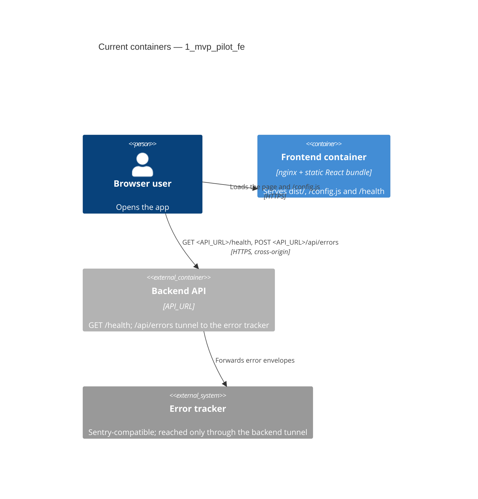

# Architecture map — 1_mvp_pilot_fe

> The **current** architecture (what exists today), produced by `map-architecture` and read by
> write-prd / architecture-design / generate-data-model / implement-tasks. Refresh with
> `/sdlc-map-architecture` when the repo drifts past `reflects_commit`. This is generated; a
> hand-maintained `docs/architecture.md`, if present, is authoritative and reconciled below — not
> replaced.

## Stack

- Language / runtime: TypeScript ~5.6 in the browser; Node.js 24 for the build and tests (`.nvmrc`).
- Frameworks: React 18, Vite 6, `@sentry/react` for error reporting (`package.json:16`). No router, no state or
  data-fetching library.
- Build / test / lint: `npm run build` (`tsc -b && vite build`, `package.json:8`), `npm test` (Vitest over
  `src/**/*.test.{ts,tsx}` and `tests/**/*.test.ts`, `vite.config.ts:10`), `npm run lint` (ESLint),
  `npm run typecheck` (`tsc -b`). The full CI list is in `CLAUDE.md` §Commands.
- Runtime: one nginx image serving `dist/` (`Dockerfile:9`), deployed with Kamal 2 to dev and promoted unchanged
  to prod (`deploy/promote.sh:15`).

## C4 — system as it is

## Module inventory

| Module | Path | Layers | Wired at | Responsibility |
|---|---|---|---|---|
| Entry point | `src/main.tsx` | app | `src/main.tsx:11` | Reads the runtime config, starts Sentry, triggers an error test, mounts `App` inside the error boundary |
| App screen | `src/App.tsx` | ui | `src/main.tsx:20` | The only screen: config summary and the API status from `fetchApiStatus` |
| Error fallback | `src/ErrorFallback.tsx` | ui | `src/main.tsx:19` | Shown by the error boundary; says whether the error was reported |
| Runtime config | `src/config.ts` | infra | `src/config.ts:15` | `readConfig` turns `window.APP_CONFIG` into a complete `AppConfig` with defaults |
| Error reporting | `src/sentry.ts` | infra | `src/main.tsx:12` | `initSentry`: off without a DSN, tunnel through the backend |
| Error test | `src/errorTest.ts` | app | `src/main.tsx:14` | `?error-test=<kind>&marker=<id>` deliberate errors for end-to-end checks |
| Config writer | `docker/40-config-js.sh` | infra | `Dockerfile:11` | Writes `/config.js` from the container environment at start, rejecting unsafe characters |
| Web server | `nginx.conf` | infra | `Dockerfile:10` | Static files, SPA fallback, `/config.js` uncached, `/health` |
| Deploy (ops) | `deploy/`, `config/deploy*.yml`, `.github/workflows/` | ops | `deploy/lib.sh:36` | Kamal deploy, rollback, promotion and guards; not part of the bundle |

## Conventions (cited — the rules a new feature must match)

- **Module wiring / registration:** explicit imports from `src/main.tsx`; configuration is passed down as props
  (`config`), never read from globals inside components — `src/main.tsx:20`
- **Error handling:** network failures become a displayed state (`unreachable`), uncaught errors go to the Sentry
  error boundary — `src/App.tsx:22`, `src/main.tsx:19`
- **IDs:** none (no entities in the frontend).
- **Persistence / DB access:** none.
- **Migrations:** none.
- **Tests:** Vitest with Testing Library in jsdom, `fetch` stubbed with `vi.stubGlobal`, next to the module
  (`src/App.test.tsx:46`); shell scripts and workflows tested from `tests/` with fake commands on `PATH`
  (`tests/support.ts:27`).
- **Inter-module communication:** direct calls and props; HTTP only to the backend via `fetch` — `src/App.tsx:17`
- **UI / styling:** no component library; plain global CSS imported per module — `src/App.tsx:2` (detail in
  §Frontend / UI foundation below)

## Datastores

| Store | Engine | Accessed via | Notes |
|---|---|---|---|
| none | — | — | Browser app; no local storage, cookies or IndexedDB in use |

## Frontend / UI foundation

Boundaries pending operator confirmation (C3 after-merge gate).

- **Component library / design system:** none. Two components, `App` and `ErrorFallback`, plus the internal
  `RenderErrorTest` (`src/App.tsx:11`). A new component is the first shared one — `src/ErrorFallback.tsx:1`
- **Design tokens:** no token system. Colours and sizes are hard-coded in `src/App.css:5-14` (`#282c34`, `white`,
  `calc(10px + 2vmin)`); `index.html:6` sets `theme-color`. A first shared token file would be new.
- **Styling approach:** plain global CSS imported by the module that uses it: `src/index.css:3` (body font stack,
  imported at `src/main.tsx:4`) and `src/App.css` (`.App`, `.App-header`, `.api-info`). No CSS modules, Tailwind
  or CSS-in-JS.
- **Shared primitives:** none.
- **Runtime `/config.js`:** `index.html:9` loads `/config.js` before the bundle. At container start
  `docker/40-config-js.sh:31` writes `window.APP_CONFIG` from `API_URL`, `SENTRY_DSN`, `ENV_NAME` and
  `KAMAL_VERSION` (as `APP_VERSION`), after rejecting characters outside the URL set. `src/config.ts:15`
  (`readConfig`) applies defaults. nginx serves it with `no-store` (`nginx.conf:15`). Locally, the gitignored
  `public/config.js` plays its part. No environment value is compiled into the bundle
  (`scripts/check-bundle-config.sh` in CI).
- **Routing:** none. A single page and no router dependency in `package.json`; nginx falls back to `index.html`
  (`nginx.conf:7`), so client-side routing would work if a router were added.
- **API client:** no client module. `fetchApiStatus` (`src/App.tsx:15`) calls `fetch` on `<API_URL>/health`,
  cancelled by an `AbortController` in `useEffect` (`src/App.tsx:31`). Errors reach the tracker only through the
  backend tunnel `tunnel: <API_URL>/api/errors` (`src/sentry.ts:11`).
- **State / data-fetching:** React `useState` / `useEffect` only; no store or server-cache library —
  `src/App.tsx:29`
- **Closest UI precedent:** a new screen or component looks like `App` (`src/App.tsx:27`) with its test
  `src/App.test.tsx` (Testing Library, stubbed `fetch`).

## Where things live / closest precedents

- A new screen / UI component → `src/<Name>.tsx` with `src/<Name>.test.tsx`, modelled on `App`
  (`src/App.tsx:27`, `src/App.test.tsx:46`).
- A new runtime setting → a field in `AppConfig` (`src/config.ts:1`), written by `docker/40-config-js.sh:31` and
  passed to the container by Kamal (`config/deploy.yml:22`).
- A new backend call → a function like `fetchApiStatus` (`src/App.tsx:15`) against `<API_URL>`, only for
  operations in the synced `contracts/`.
- A new deploy or CI script → `deploy/` or `scripts/`, with a `tests/*.test.ts` that runs it with fake commands
  (`tests/support.ts:27`).

## Constraints & known tech-debt

- Build once: one image per commit, deployed to dev and promoted unchanged to prod (`deploy/promote.sh:15`) — new
  work must not need a per-environment build.
- No environment values in the bundle: hosts, DSNs and the environment name come only from `/config.js`
  (`CLAUDE.md` Hard Rules; `scripts/check-bundle-config.sh src dist` in CI).
- The specs under `docs/features/<slug>/` are read-only `sync-spec` copies of the backend's; none exist yet.
- The TDD commit order is enforced on every pull request that changes code (`tdd-check`, `scripts/tdd-check.sh`).
- No design system, router or API client exists yet; the first feature that needs one introduces it in its own
  task and records it here.

## Reconciliation with the authored architecture doc

No authored architecture doc; this map is the current reference. The README sections "Runtime config", "Error
reporting" and "Deploy" are the operational reference and agree with this map.
