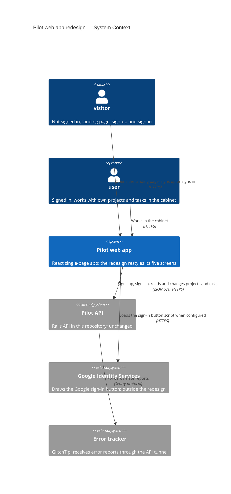
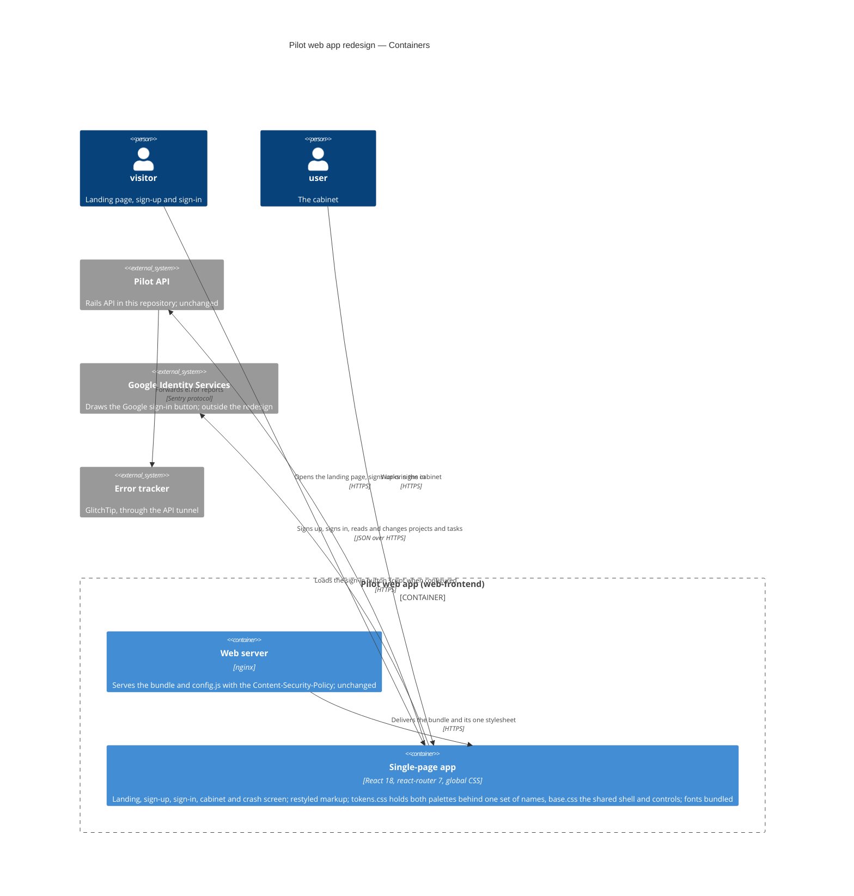
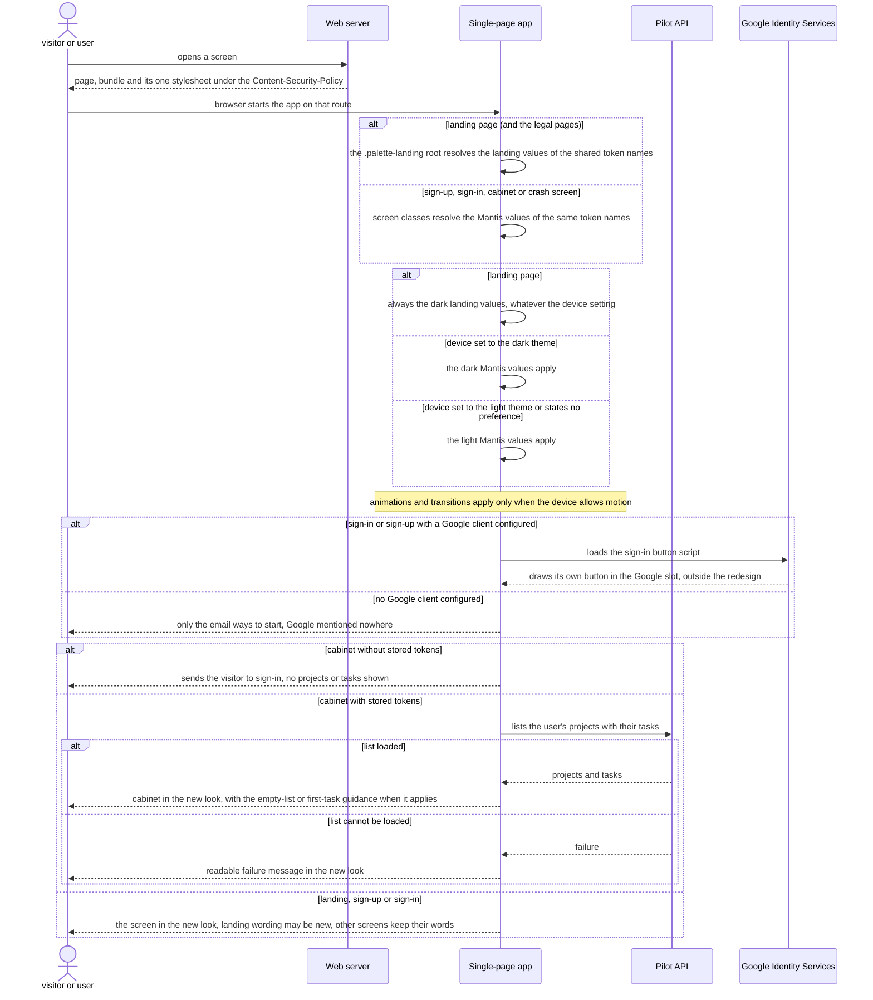
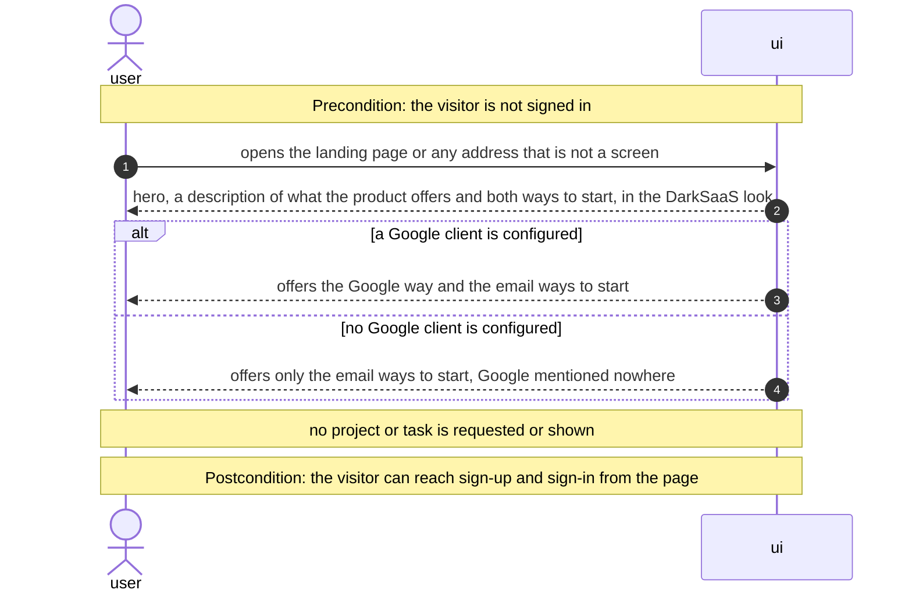
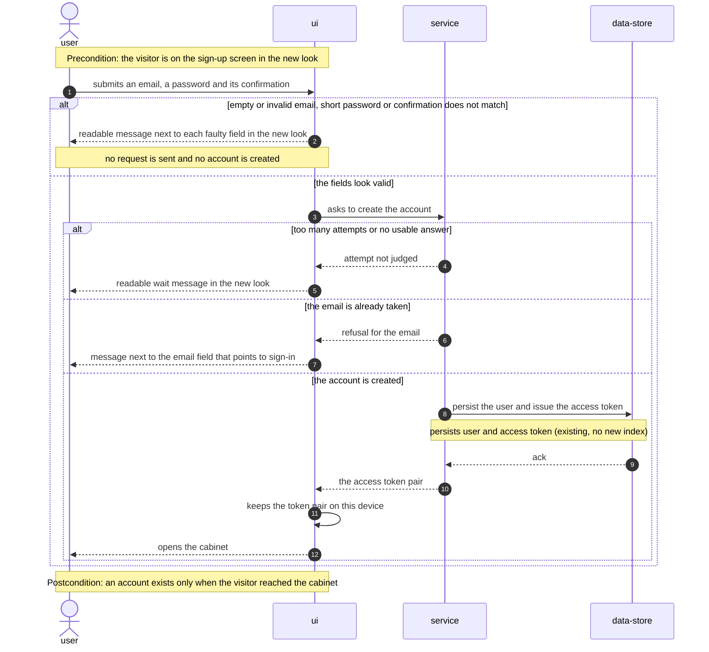
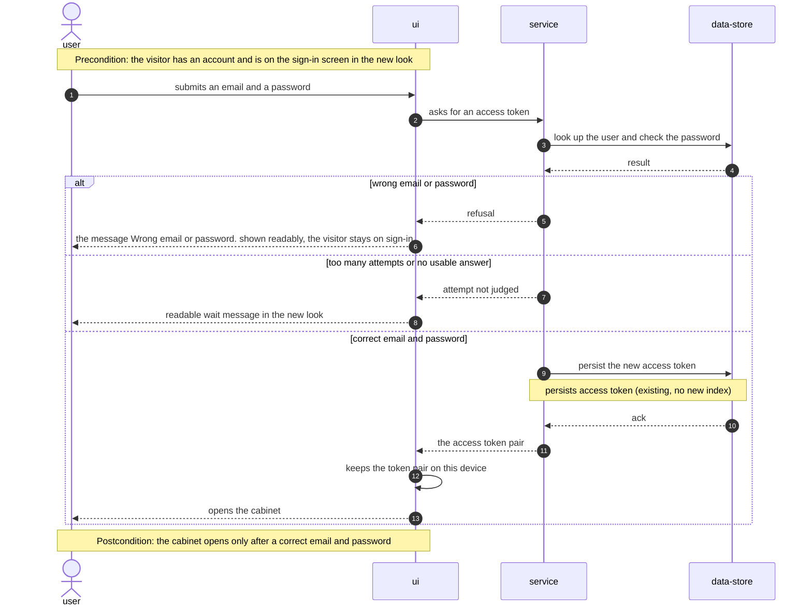
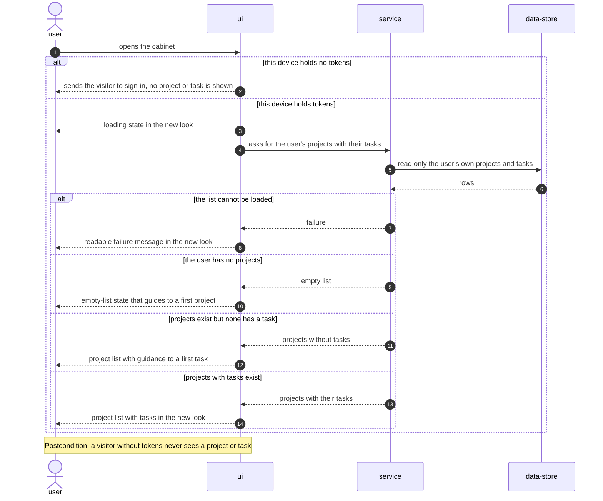
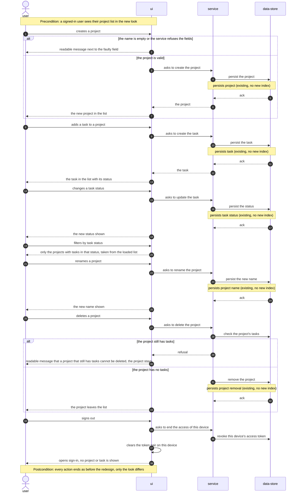
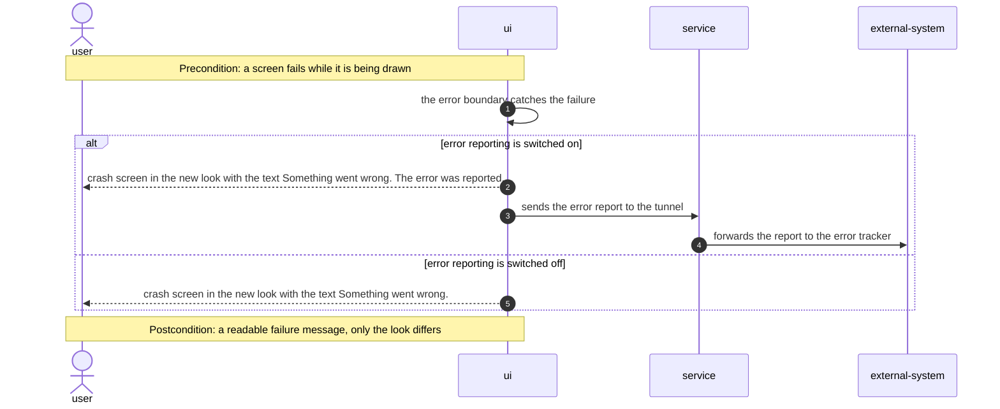
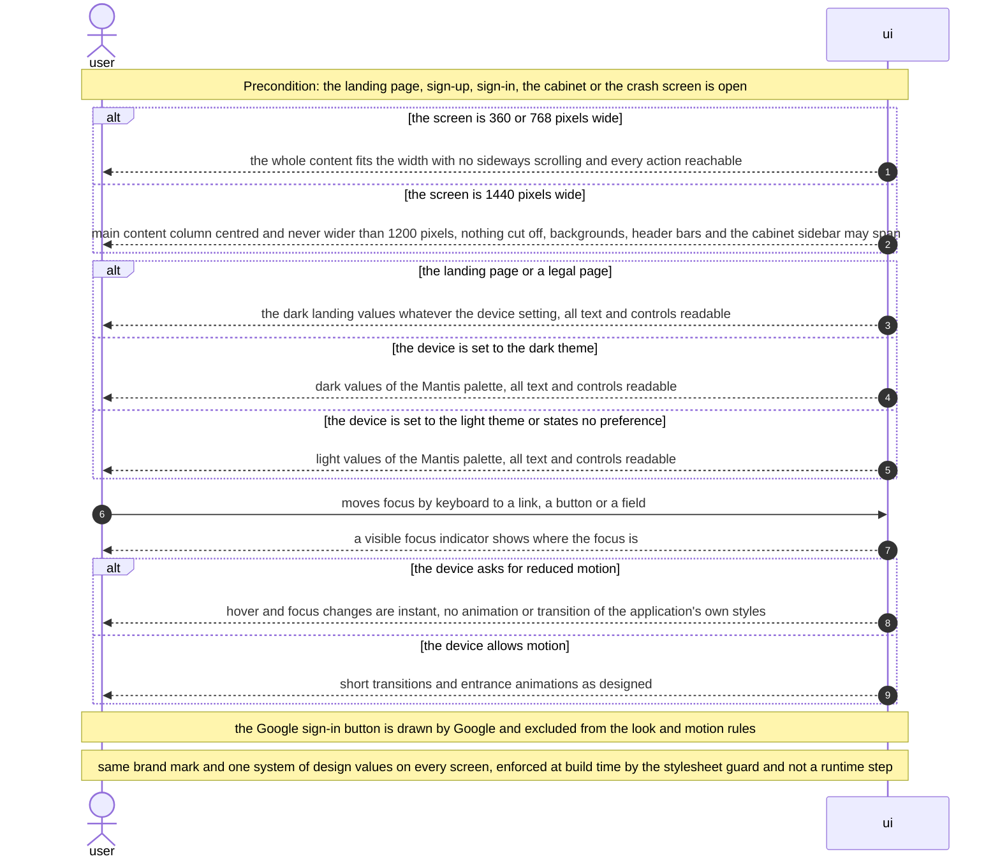

<!-- Copied from be@5663ab6a7e9aeaf70237a282dabec48f2c6b1ca4:docs/features/redesign/sad.md by sync-spec. Do not edit here. -->

# Software Architecture Document — redesign

<!-- Stages 04-05 → see sdlc/plugin/skills/architecture-design/SKILL.md -->
<!-- 12 Arc42 sections. Empty sections — <!-- N/A: <one-line reason> -->. -->
<!-- C4 Context (L1) lives inline in §3. C4 Container (L2) lives inline in §5. -->
<!-- §6 Runtime view seeds the primary flow(s) here; complete-sequence-diagrams (stage 06) then -->
<!--    fills §6 with every critical flow / §5 AC — no cap. -->
<!-- Numbers in §10 come VERBATIM from PRD §6 NFR — no inventing, no rounding. -->

## 1. Introduction and goals

<!-- 🎯 Навіщо: стабільна памʼять про «що + три головні якості + хто зацікавлений».     -->
<!--           Через рік ніхто не згадає на словах, ЯКІ ТРИ ЯКОСТІ для системи критичні. -->
<!-- 📋 Що писати: 1 абзац intent + 3 рядки топ-3 якості + таблиця stakeholders.        -->
<!-- 📌 Приклад: «QG-1: швидкість редагування блоку p95 ≤500 мс»                         -->

**Intent.** Redesign the four screens of the Pilot web app — the landing page, sign-up, sign-in and the cabinet —
and its crash screen into a modern look — the landing page always dark, the other screens in both the light and the
dark theme — for visitors and users (and the reviewers and demo audiences who meet the product as them). Each screen matches its reference: DarkSaaS for the landing
page (dark background, gradients, accent colours, a hero; new sections, visuals and wording allowed), and Mantis for
sign-up and sign-in (the auth pages) and the cabinet (sidebar, top bar, cards). One brand mark and one system of design
values join them, with one palette and gradient set for the landing page and one for the other screens. The change lives
entirely in the existing React frontend: design values, a shared base stylesheet and each screen's own stylesheet and
markup. Behaviour, API and backend do not change; no template code is copied and no paid asset or component library
is added ([PRD](./PRD.md) §1–§3, scope change of 2026-10-29).

This revision (2026-10-29) follows the owner's scope change. It replaces ADR-0001 with ADR-0005 (the landing palette)
and adds ADR-0006 (typefaces); ADR-0002 to ADR-0004 stand, with dated amendments.

**Top quality goals (1-liners; full scenarios in §10):**

1. **QG-1 Behaviour preserved** — 0 behaviour regressions; only the listed visual-value assertions change.
2. **QG-2 One system of design values** — 0 raw values (PRD §1) outside the design-value variables; two palettes,
   each in both themes, behind one set of role names; the same brand mark on every screen.
3. **QG-3 Accessible in both themes** — contrast ≥ 4.5:1 for all text and ≥ 3:1 for non-text parts (control borders
   and fills, focus rings, status icons), a visible focus indicator, no animation under reduced motion.
4. **QG-4 Fits every width** — 0 px of sideways overflow at 360 and 768 px; the main content column never wider
   than 1200 px at 1440 px.

When two goals pull against each other, the lower number wins (for example, a layout that would need a markup change
breaking a behaviour test gives way to QG-1).

**Stakeholders.**

| Role | Interest | Sign-off owner? |
|---|---|---|
| visitor | Sees the landing page, sign-up and sign-in in the new look, including their error messages | No |
| user | Works in the cabinet in the new look; every action behaves as before | No |
| Reviewers and demo audiences | Judge the product's presentability; they meet it as visitors and users | No |
| Owner (OlegShevtsov1) | Approves each screen from before-and-after screenshots (PRD §6, Visual approval) | Yes — visual approval |
| Tech Lead | SAD approval | Yes |

<!-- Decision overrides (¶4) — populated by the Step-7 critic resolution loop, empty otherwise.       -->
<!-- Each: «Decision override: <headline> — rationale: <reason>» so downstream skills see the choice.  -->

## 2. Constraints

<!-- 🎯 Навіщо: §4 (стратегія) працює тільки коли §2 зафіксувала, ЩО ВЖЕ ЗАФІКСОВАНО:    -->
<!--           стек, версії, дедлайн, регуляторні вимоги. Це вхід, не вихід.             -->
<!-- 📋 Що писати: чотири блоки — Технічні / Організаційні / Конвенції / Регуляторні.     -->
<!-- 📌 Приклад: «Postgres 18» (не «Postgres»); «дедлайн Q3 — жорсткий» (не «бажано»).    -->

**Technical.** (frontend repository `1_mvp_pilot_fe`, its `docs/architecture-map.md`)
- TypeScript ~5.6, React 18.3, Vite 6, `react-router` 7 — the existing client-side app; no state or data-fetching
  library.
- Plain global CSS imported by the module that uses it (`src/index.css`, `src/App.css`, `src/routes/Landing.css`,
  `src/routes/AuthForm.css`, `src/routes/Dashboard.css`, and since PILOT-419 `src/routes/SiteChrome.css` and
  `src/routes/Legal.css`); no CSS modules, Tailwind, CSS-in-JS or component library.
- The cabinet already has a sidebar, a top bar with a menu toggle that opens the sidebar below `48rem`, and cards
  (`src/routes/Dashboard.tsx`, PILOT-248 to PILOT-273); the redesign restyles them and adds no new control.
- Done in the frontend before this revision: T1 stylesheet guard (fe #74), T2 Mantis token values (fe #76), T4
  end-to-end visual-check helpers (fe #75). T3 (`base.css`, `BrandMark`) is fe PR #77, open.
- Design values are CSS custom properties on `:root` in `src/styles/tokens.css`, imported first in `src/main.tsx`;
  the dark set lives under `@media (prefers-color-scheme: dark)` with `color-scheme: light dark`, so the theme follows
  the device (the landing page, always dark since 2026-10-29, is the exception, ADR-0005) and there is no toggle.
- Typefaces may change (PRD §1, 2026-10-29): fonts are free-licence and self-hosted through `@fontsource-variable/*`
  packages. Public Sans becomes the body face and Space Grotesk stays for display and the brand (ADR-0006).
- The Content-Security-Policy in `nginx.conf` allows `default-src 'self'`, `style-src 'self'` plus Google's button
  styles and `img-src 'self' data:`: a third-party font or image is blocked by the server itself.
- CSS custom properties cannot be used in `@media` conditions, so breakpoints (today `48rem` and `64rem` in
  `Landing.css`) stay literal values.
- Build once: one image per commit, deployed to dev and promoted unchanged to prod.
- The backend (Rails 7.2 API, this repository) and its contract `swagger/v1/swagger.json` do not change (PRD §3).

**Organisational.**
- 4 of 4 screens approved by the owner by 2026-11-30 (PRD §7); about 2 person-weeks of effort (idea brief §11).
- One pull request per screen, the shared design values first; dev shows a mixed old and new look until the last
  screen has merged (PRD §1, Delivery).
- One task is at most one day of work and at most 500 changed lines (`CLAUDE.md`).
- One developer with the factory (`implement-tasks`); the owner approves each screen from screenshots.

**Conventions.**
- Frontend `CLAUDE.md` and backend `CLAUDE.md`: the TDD check (the first commit is a failing `test(...)`), a
  `CHANGELOG.md` entry for `feat` pull requests, and the specs under `docs/features/redesign/` are read-only
  `sync-spec` copies in the frontend.
- Visual-value assertions (PRD §1) are updated openly in the pull request that changes the look, each listed in its
  description; behaviour checks are never touched; adding colour pairs to the contrast test counts as strengthening.
- Screens use route paths from `src/routes/paths.ts` and the shared `TextField`; tests use Testing Library roles and
  text, with few class selectors.

**Regulatory / external.**
- Licences: no template code, fonts or images of the templates enter the repository, now or later, and no paid asset
  is used (PRD §3, §6.1). Mantis's free edition is MIT but bound to a component library we do not use; DarkSaaS is paid
  with unconfirmed terms; their look is ported into our own styles. A font or image that is free-licence or drawn by us
  may be added, self-hosted and listed with its licence in the pull request (PRD §6).
- The repository is or will become public: no internal hostnames or addresses in styles, tests or screenshots.
- No personal data is added and no authorization boundary changes; security review N/A (PRD §6.1).

## 3. Context and scope

<!-- 🎯 Навіщо: малює КОРДОН СИСТЕМИ — хто з нею говорить ззовні, де закінчується зона довіри. -->
<!--           Без §3 §5 і §8 (авторизація) розпливаються — неясно, що «всередині», а що «зовні». -->
<!-- 📋 Що писати: 2-3 речення бізнес-контексту + таблиця зовнішніх систем + Mermaid C4Context. -->
<!-- 📌 Приклад: «зовнішні — нема (свідома відмова від third-party у v1)» — це теж рішення.   -->
<!-- Кордон довіри (trust boundary) — лінія, за якою ти не довіряєш даним без перевірки.       -->

The Pilot web app is the browser front of the demo and portfolio MVP: visitors meet the landing page, sign-up and
sign-in, and users work with their projects and tasks in the cabinet. The redesign changes only how the web app looks;
everything it exchanges with the outside — the Pilot API, Google sign-in and error reports — stays exactly as it is.
The feature's scope boundary is therefore the web app's own stylesheets and markup; the trust boundary does not move.

**External systems (in / out):**

| Actor or system | Type | Interaction |
|---|---|---|
| visitor | Person | Opens the landing page, signs up or signs in |
| user | Person | Works with their own projects and tasks in the cabinet, signs out |
| Pilot API | System (internal, this repository) | Sign-up, sign-in, projects and tasks over JSON and HTTPS; unchanged |
| Google Identity Services | System (external) | Loads and draws the Google sign-in button on sign-in and sign-up when a Google client is configured; outside the redesign (PRD AC-14, AC-15) |
| Error tracker (GlitchTip) | System (external) | Receives the web app's error reports through the Pilot API's tunnel; unchanged |
| Mantis, DarkSaaS | Visual references (not systems) | Looked at by the developer only; their look is ported, no template code, fonts, images or runtime requests |

**C4 Context (L1):**



## 4. Solution strategy

<!-- 🎯 Навіщо: 3-4 СТРАТЕГІЧНІ СТОВПИ, з яких потім ростуть усі ADR. Без §4 кожен ADR    -->
<!--           виглядає випадковим — нема зонтика. ⭐ Найгустіша секція — тут ADR-gate    -->
<!--           спрацьовує майже завжди (рішення незворотні + мульти-модульні).            -->
<!-- 📋 Що писати: спершу Target surface(s), потім 3-4 стратегічні вибори.                -->
<!--           На кожен — заголовок + 2-3 речення rationale.                              -->
<!-- 📌 ПЕРШЕ рішення §4 — Target surface(s): ЩО САМЕ будуємо. Записується у frontmatter   -->
<!--           target_surfaces: [...] і гейтить §5 (один контейнер на поверхню) + усі       -->
<!--           наступні стадії. Деривиться з PRD §1 «для кого» + §4 ролей. → _shared/surfaces.md -->
<!-- 📌 Приклад: «Зберігати урок як таблицю блоків» — стовп, з якого виросло ADR-0001.    -->

**Target surface(s) (the first decision — what's being built):** `[web-frontend]`

Only the browser app (`1_mvp_pilot_fe`) changes. PRD §1 is about what visitors and users see, and PRD §3 rules out
backend, API, analytics and conversion-tracking changes; this repository holds the feature's documents but no code of
the feature. A single surface crosses no blast-radius criterion, so the choice is inline. Downstream: `api-forge` only
consumes the existing contract (no new operation), `break-tasks` creates `ui` tasks only, and `plan-tests` adds the
component, visual and end-to-end-through-the-UI tiers.

**UI architecture (web-frontend):** unchanged — the client-side single-page app in the existing React app (React 18,
`react-router` 7, static files served by nginx), as decided in todolist ADR-0002
(`docs/features/todolist/adr/0002-client-side-spa-in-existing-react-app.md`). The redesign reuses the existing
foundation from the frontend's `architecture-map.md` §Frontend: the tokens in `src/styles/tokens.css`, plain global CSS
per module, the shared `TextField` and `ProjectForm`, the cabinet's existing sidebar and top bar, and no component
library (idea brief §13: Approach A; a component library or an own component set stays parked, idea brief §14). No ADR:
nothing changes, and server rendering would be a deployment and behaviour change PRD §3 excludes.

**Top strategic choices (the seeds for ADRs):**

1. **One layer of role-named tokens, with the landing palette as a scoped override of the same names** — `:root`
   holds the Mantis values T2 wrote (ADR-0001, now superseded); a `.palette-landing` class on the landing root redefines
   the same colour, gradient and shadow names for the DarkSaaS look, in both themes. Shared controls and screen
   stylesheets read one set of names and take the right palette by inheritance (QG-2); every value stays a literal the
   contrast test can read (QG-3). → ADR-0005 (supersedes ADR-0001).
2. **A Vitest scan over every stylesheet guards the values and the motion** — one new unit test fails on raw colours,
   type sizes, spacing, radii or shadows outside `tokens.css` and on any animation or transition outside
   `prefers-reduced-motion: no-preference`, extending today's landing-only checks to all screens (QG-2, QG-3). It is
   the RED-first unit test PRD §6 names and adds no dependency. → ADR-0002.
3. **Token values change first, then one screen per pull request** — the shared values (T1–T4) come first, then
   the landing page with its palette, sign-up, sign-in, and the cabinet with the crash screen. There is one token file
   with one set of role names at every point in time and no cleanup pull request; the mixed look on dev is the one
   PRD §1 accepts (QG-1, QG-2). → ADR-0003 (amended 2026-10-29).
4. **Public Sans for body text, Space Grotesk for display** — one self-hosted, OFL-licensed body face on every screen
   brings the Mantis screens to their reference type, and the landing hero and the brand keep their display face; no
   third-party request (QG-1, US-08). → ADR-0006.

Each tactical decision in later sections should be traceable to one of these strategic seeds. Tactical decisions that *contradict* a strategic choice are red flags — surface them in §11 Risks.

## 5. Building block view

<!-- 🎯 Навіщо: ВНУТРІШНЯ ДЕКОМПОЗИЦІЯ — модулі, контейнери, БД. Статична топологія:   -->
<!--           хто з ким може говорити. Без §5 §6 (сценарії) не має словника учасників. -->
<!-- 📋 Що писати: 1 абзац про стиль (шари/гексагональна/clean/на подіях) +            -->
<!--           дерево папок + Mermaid C4Container.                                       -->
<!-- 📌 ОДИН Container на кожну оголошену target_surface (frontmatter): fullstack        -->
<!--           [backend-service, web-frontend] = backend-API container + web/SPA container; -->
<!--           [backend-service, mobile-app] = API + mobile app. Container(web, …) нижче — -->
<!--           лише приклад однієї поверхні; додай/заміни під оголошене у §4. → _shared/surfaces.md -->
<!-- 📌 Приклад: «web-app, content-api, media-worker, postgres, s3, cdn».                -->

The frontend keeps its existing layering: screens are React components in `src/routes/`, each importing its own global
stylesheet, and design values live only in `src/styles/tokens.css`. The redesign adds one shared base stylesheet for
the rules several screens share (ADR-0004), one shared brand-mark component and a scoped landing palette (ADR-0005);
it adds no container, no datastore and no component library. Behaviour code (`src/api/`, `src/auth/`, the screens'
state and handlers) is not touched. Markup changes are limited to wrappers, class names and decorative elements the
new look needs; on the landing page, wording and sections may also change (PRD AC-01), and on the other screens the
visible text stays as it is.

**Internal decomposition** (frontend repository `1_mvp_pilot_fe`):

```
src/main.tsx                  imports both fonts (ADR-0006), tokens.css, then base.css (replaces the index.css import)
src/styles/tokens.css         :root Mantis values, light and dark (T2) + one dark .palette-landing block and gradients (ADR-0005)
src/styles/base.css           NEW: body (from index.css), .page shell (from Landing.css, 1200 px width),
                              header + brand mark, buttons, links, inputs, focus ring, alerts (ADR-0004)
src/index.css                 removed once its body rules have moved (its code font moves with them)
src/App.css                   unchanged apart from values: the dev-only footer
src/routes/BrandMark.tsx      NEW: the landing Logo graphic only, extracted from Landing.tsx (decorative)
src/routes/Landing.tsx        root carries .palette-landing; hero, sections and visuals in the DarkSaaS look (inline SVG)
src/routes/Landing.css        landing composition: hero, gradients, sections; always dark, root paints the full-viewport background
src/routes/SiteChrome.tsx     landing header (BrandMark + "Pilot App" link) and legal footer, shared with /privacy, /terms
src/routes/Legal.tsx          root keeps sharing the landing chrome and carries .palette-landing (not one of the four screens)
src/routes/SignUp.tsx         Mantis auth card; adds a header with BrandMark (not a link)
src/routes/SignIn.tsx         Mantis auth card; adds a header with BrandMark (not a link)
src/routes/AuthForm.css       auth card, sign-up, sign-in and project forms, field errors, alerts
src/routes/Dashboard.tsx      existing sidebar, top bar and menu toggle restyled; BrandMark in the sidebar head
src/routes/Dashboard.css      Mantis dashboard look: sidebar, top bar, cards, list, filter, guidance, loading, empty,
                              failure and delete-refused states
src/ErrorFallback.tsx         same role and text, wrapped in the .page shell; no stylesheet of its own
tests/design-tokens.test.ts   new foreground/background pairs in both themes
tests/stylesheets.test.ts     NEW: the value and motion guard (ADR-0002)
e2e/                          width, theme, focus and third-party-request checks per screen (§10)
```

**Tactical decisions (inline):**

- **The brand mark is the logo graphic only, and keeps today's links.** `BrandMark` is the existing landing logo
  (AC-15 asks for exactly that) and is decorative (hidden from assistive technology; the page's `h1` names the
  screen). Where a brand link exists today — the landing and legal header and the cabinet — it keeps its text and
  target; sign-up and sign-in show the graphic alone in a `<header>`. No new navigation path and no new keyboard stop
  (QG-1); sign-up and sign-in keep their "Back to the start" link.
- **The cabinet's Mantis shell is the shell it already has.** The sidebar (project navigation, new project, sign-out),
  the top bar and its menu toggle (`aria-expanded`, `aria-controls`; the sidebar is closed below `48rem`) and the cards
  exist since PILOT-248 to PILOT-273. The redesign restyles them to the Mantis dashboard look and moves no action; the
  phone toggle is the "one sidebar toggle" of PRD AC-11. No new component and no ADR: a single screen, reversible.
- **Sign-up and sign-in take the Mantis auth layout:** the form in a centred card on the page background, the brand
  mark above it. Field order, labels, messages and the Google slot are unchanged.
- **Landing visuals are inline SVG drawn in our code or self-hosted free-licence image files** under `src/assets/`
  (hashed by Vite, served from `'self'`); each file is listed with its licence in the pull request. Any new call to
  action leads only to sign-up or sign-in (PRD §3).
- **`BrandMark` sits next to `TextField` in `src/routes/`,** the repository's place for shared screen pieces; no new
  `src/components/` folder.
- **The crash screen has no stylesheet of its own:** it keeps its `alert` role and a readable failure text (today's
  text, checked by `src/ErrorFallback.test.tsx`) and takes the Mantis look from the `.page` shell and the base alert
  style.

**C4 Container (L2):**



## 6. Runtime view

<!-- 🎯 Навіщо: ПОТІК У RUNTIME для 1-2 критичних сценаріїв. Хто з ким коли і у якому     -->
<!--           порядку говорить. Без §6 §5 — лише купа коробок без життя.                  -->
<!-- 📋 Що писати: Mermaid sequenceDiagram. Учасники — імена з §5 (не вигадуй нові!).      -->
<!--           Повідомлення семантичні («складає чорновик»), БЕЗ HTTP-методів/шляхів —     -->
<!--           ендпоінт-рівневі sequence-діаграми зʼявляться у stage 06 (api-forge).        -->
<!-- ⏳ RESERVED FOR SEQUENCES: architecture-design сіє лише primary flow(s) тут.          -->
<!--           complete-sequence-diagrams (stage 06) ДОПОВНЮЄ §6 кожним критичним flow /    -->
<!--           кожним §5 AC — без обмеження. Не намагайся покрити все тут.                  -->
<!-- 📌 Приклад: «methodist → web-app: складає чорновик → web-app → content-api: зберегти». -->

**Critical flow 1: open any screen in the new look**

The browser, not the app, picks the theme and the motion: both are media conditions over one set of token names, so no
script decides them and no request carries them. The flow is the same for the five screens; only the cabinet calls
the Pilot API, and only sign-in and sign-up load Google's button.



The flows below (written by `complete-sequence-diagrams`) use the generic participants `user`, `ui`, `service`,
`data-store` and `external-system`: `ui` is the single-page app, `service` is the Pilot API, `data-store` is its
database and `external-system` is Google's sign-in script or the error tracker. The redesign stores nothing new, so every
persist note below is an existing write and adds no index.

### Landing page



### Sign up



### Sign in



### Open the cabinet



### Work in the cabinet



### Crash screen



### Cross-cutting: presentation rules on any screen



### Coverage of user stories and acceptance criteria

| Story | Flow | Acceptance criteria |
|---|---|---|
| US-01 | Landing page | AC-01 (happy path), AC-02 (`alt`: no Google client) |
| US-02 | Sign up | AC-03 (account created branch), AC-04 (`alt`: invalid fields, taken email, wait message) |
| US-03 | Sign in | AC-05 (correct email and password), AC-06 (`alt`: wrong email or password) |
| US-04 | Open the cabinet, Work in the cabinet, Crash screen | AC-07 (every action), AC-08 (`alt`: project still has tasks), AC-09 (`alt`: no tokens), AC-10 (`alt`: list cannot be loaded, loading, empty and guidance states; crash screen flow) |
| US-05 | Cross-cutting | AC-11 and AC-16 (`alt`: widths) |
| US-06 | Cross-cutting, and the theme branch of the first flow above | AC-12 (`alt`: landing always dark, other screens dark or light) |
| US-07 | Cross-cutting, and the motion note of the first flow above | AC-13 (keyboard focus), AC-14 (`alt`: reduced motion) |
| US-08 | Cross-cutting | AC-15: explicit non-runtime N/A. The brand mark and the design values (two palettes behind one set of names) are enforced at build time by `tests/stylesheets.test.ts` (ADR-0002) and by review, and no runtime message carries them. |

**Flagged, not decided here:** no participant outside §5 was needed. The first flow in this section names concrete
boxes from §5 because architecture-design seeded it; the flows added by this stage stay generic.

## 7. Deployment view

<!-- 🎯 Навіщо: ТОПОЛОГІЯ, яку DevOps має знати без читання Helm-чартів — скільки реплік,  -->
<!--           де живе фоновий обробник, ПРИ ЯКИХ ЧИСЛАХ масштабуємось.                     -->
<!-- 📋 Що писати: 2-3 речення про топологію + метрики + алерти + конкретні числа-пороги.   -->
<!-- 📌 Приклад: «500 IC → партиціонування за кварталом» (не «при зростанні подумаємо»).    -->
<!-- 🎯 Можна N/A для XS/S функцій, що переюзають існуюче розгортання без змін.            -->

<!-- N/A: reuses the existing deployment unit unchanged -->

The redesign ships in the same nginx image of the frontend, built once per commit, deployed to dev by Dev Deploy on
`develop` and promoted unchanged to prod by `Kamal Deploy`, with the same Content-Security-Policy and the same runtime
`/config.js`. Nothing new runs and no load changes, so there are no scaling thresholds; monitoring stays the error
tracker reached through the backend tunnel. The one deployment-visible effect is that dev shows a mixed old and new look
between the screen pull requests, which ADR-0003 accepts.

## 8. Crosscutting concepts

<!-- 🎯 Навіщо: НАСКРІЗНІ ПАТЕРНИ, які перетинають кілька модулів: логування, помилки,    -->
<!--           авторизація, ID strategy, outbox, кеш. ⭐ Друга найгустіша секція.          -->
<!--           Якщо патерн всередині одного модуля — він НЕ сюди. Якщо це конвенція        -->
<!--           проєкту в цілому — у CLAUDE.md.                                              -->
<!-- 📋 Що писати: таблиця концепт / конвенція / де визначено. Один рядок на концепт.      -->
<!-- 📌 Приклад: «UUID v7 (час+випадковий, сортується) у app-layer» — як default з CLAUDE.md. -->

| Concept | Convention | Where defined |
|---|---|---|
| Theming | Sign-up, sign-in, the cabinet and the crash screen follow the device through `prefers-color-scheme` over one set of token names, light when it states no preference; every `--color-*` on `:root` exists in the light and the dark set. The landing page (and the legal pages) is always dark: its `.palette-landing` block sits outside any theme query (owner, 2026-10-29; PRD AC-12). No toggle | `src/styles/tokens.css`, ADR-0005 |
| Palettes | Two palettes behind one set of role names: Mantis on `:root`, the DarkSaaS look under `.palette-landing` on the landing root (and the legal pages that share its chrome); a role the landing block does not override falls back to the Mantis value | ADR-0005 |
| Design values | Outside `tokens.css` only `var(--…)` names for colours, gradients, type sizes, spacing, radii and shadows; raw value and allow-list as defined in PRD §1; breakpoints stay literal inside `@media` because variables cannot be used there | ADR-0002 (amended), ADR-0005 |
| Motion | `animation` and `transition` only inside `@media (prefers-reduced-motion: no-preference)`, so under reduced motion hover and focus changes are instant | the landing convention, generalised by ADR-0002 |
| Focus | One `:focus-visible` outline in `var(--color-focus)` for every link, button and field | `src/styles/base.css`, ADR-0004 |
| Contrast | Every foreground and background pair the new styles use is added to `tests/design-tokens.test.ts` in both themes and for both palettes (≥ 4.5:1 for all text, ≥ 3:1 for non-text parts, disabled controls exempt); text over a gradient or translucent layer is checked against its worst-case background, computed by hand and listed | PRD §6, ADR-0005 |
| Responsive layout | Mobile-first; breakpoints `48rem` (768 px) and `64rem`; the main content column is centred and at most 1200 px wide (`--content-width-max`); full-width backgrounds, header bars and the cabinet sidebar may span; below `48rem` the cabinet sidebar sits behind its one existing menu toggle | `src/styles/base.css`, `Dashboard.css`, PRD AC-11, AC-16 |
| Fonts, icons, images | Public Sans (body) and Space Grotesk (display, brand) from `@fontsource-variable/*`, both SIL OFL 1.1, bundled and served from `'self'`; icons are inline SVG drawn in our own code; images are inline SVG or self-hosted free-licence files under `src/assets/`, each listed with its licence in the pull request; no template asset; the Content-Security-Policy blocks third-party files | ADR-0006, PRD §6 |
| Third-party widget | The Google sign-in button is drawn by Google and excluded from the look and the motion rules; base rules use class selectors so they never reach into its slot | ADR-0004, PRD AC-14, AC-15 |
| Visual-check seam | Width, theme, focus and third-party-request checks and the pull request screenshots (360 px and 1440 px, light and dark, reduced motion so nothing is captured mid-animation) run with `E2E_BASE_URL` at a local preview of the branch, or at dev after merge; the cabinet's states come from Playwright `page.route` answers shaped like the synced contract's responses, with a stored token pair planted before the page loads; `e2e/api.spec.ts` keeps exercising the real API | here; precedent `e2e/landing.spec.ts` |
| Visual-value assertions | An existing assertion that pins a colour, font, shadow or timing value, or the landing page's wording and sections, is updated in the pull request that changes it and listed in its description; a selector-only edit after a class rename is listed the same way; behaviour assertions are never touched | PRD §1 |
| Error handling | Unchanged: network failures are displayed states, uncaught render errors show the crash screen through the error boundary | frontend `architecture-map.md` |
| Authentication | Unchanged: token pair in the token store, the cabinet sends a device without tokens to sign-in | frontend `architecture-map.md` |
| Observability | Unchanged: errors reach the tracker only through the backend tunnel | frontend `architecture-map.md` |
| Internationalisation | N/A: English only; landing wording may change (still English), other screens keep their words | PRD §1, AC-01 |

## 9. Architecture decisions

<!-- 🎯 Навіщо: ЗВОРОТНИЙ ІНДЕКС на папку adr/. `ls adr/` дає файли, §9 дає семантику —    -->
<!--           чому вони існують, до якого зрізу SAD привʼязані, у якому статусі.           -->
<!-- 📋 Що писати: таблиця з 4 колонками. Один рядок на ADR. Mixed status — це OK.         -->
<!-- 📌 Приклад: «0001 | Зберігати урок як таблицю блоків | Accepted | §4».                -->

| # | Title | Status | Section |
|---|---|---|---|
| [0001](./adr/0001-keep-one-semantic-token-layer-rewritten-in-place.md) | Keep one semantic token layer, rewritten in place | Superseded by 0005 | §4 |
| [0002](./adr/0002-guard-design-values-and-motion-with-a-vitest-stylesheet-scan.md) | Guard design values and motion with a Vitest stylesheet scan | Accepted (amended 2026-10-29) | §4 |
| [0003](./adr/0003-switch-token-values-first-then-restyle-one-screen-per-pr.md) | Switch token values first, then restyle one screen per pull request | Accepted (amended 2026-10-29) | §4 |
| [0004](./adr/0004-share-the-page-shell-and-controls-through-one-base-stylesheet.md) | Share the page shell and controls through one base stylesheet | Accepted (amended 2026-10-29) | §5 |
| [0005](./adr/0005-scope-the-landing-palette-as-an-override-of-the-same-token-names.md) | Scope the landing palette as an override of the same token names | Accepted | §4 |
| [0006](./adr/0006-self-host-public-sans-for-body-text-and-keep-space-grotesk-for-display.md) | Self-host Public Sans for body text and keep Space Grotesk for display | Accepted | §4 |

ADR files live under `docs/features/redesign/adr/` (four-digit number, then the decision in kebab-case). Inherited, not reopened: todolist ADR-0002
(client-side SPA in the existing React app) for the UI architecture (§4).

## 10. Quality requirements

<!-- 🎯 Навіщо: ДЕРЕВО ЯКОСТЕЙ (Quality Tree) — беремо мету з §1 і розкладаємо на          -->
<!--           конкретні листя: тести, метрики, конфіги, drill-и. ⭐ Без §10 §1 — це       -->
<!--           маніфест. З §10 кожна декларація мапиться на щось, ЩО МОЖНА ДОВЕСТИ.        -->
<!-- 📋 Що писати: на кожну якість з §1 — When / Then / How verify. Числа з PRD §6 NFR     -->
<!--           ДОСЛІВНО (не округлюй p95 ≤250мс до ≤300мс — це F6-помилка критика).        -->
<!-- 📌 Приклад: «p95 ≤500 мс на UPDATE блоку, перевіримо k6 load test 100 req/s».        -->

Each top-3 goal from §1 expanded into a full scenario:

**QG-1. Behaviour preserved** (PRD §6: Behaviour regressions, New runtime dependencies and assets, Third-party font
or image requests; AC-01 to AC-10)
- **When:** a redesign pull request runs CI, and its screen is opened on the visual-check seam (§8).
- **Then:** behaviour regressions — "0 failing existing tests, none weakened or deleted, apart from the visual-value
  assertions defined in §1, each listed in the pull request"; new runtime dependencies and assets — "0 component
  libraries and 0 paid assets; a self-hosted free-licence font package or image file is allowed, each named with its
  licence in the pull request"; third-party font or image requests from the application's own styles — "0; the Google
  sign-in script and the button Google draws are excluded, and the check runs with Google configured and
  unconfigured".
- **How verify:** the frontend unit suite (`npm test`) and end-to-end suite (`npm run e2e`) in CI, with the TDD check
  on the commit order; the `package.json` diff and the file list of each pull request, with each added font package
  or image file named with its licence; an end-to-end network check per screen in which every font or image request
  started by the application's pages or styles fails the check, whatever the domain, and only requests started by
  Google's script or button are excluded, run once with a Google client configured and once without.

**QG-2. One system of design values** (PRD §6: Shared design values, Visual approval; AC-15; KPI "Screens on the new
look, approved by the owner")
- **When:** any stylesheet under `src/` other than `src/styles/tokens.css` is added or changed.
- **Then:** "0 raw values (defined in §1) in screen stylesheets outside the design-value variables"; the design values
  hold "one dark palette and gradient set for the landing page and one palette for the other screens in a light and a
  dark theme" (AC-15, ADR-0005); the same brand mark on the landing page, sign-up, sign-in and the cabinet; visual approval —
  "4 of 4 screens approved by the owner", baseline 0 of 4, by 2026-11-30.
- **How verify:** `tests/stylesheets.test.ts` (ADR-0002) over the growing `GUARDED` list, each screen's stylesheet
  added RED first and every stylesheet by the last task; a Testing Library check per screen
  that its header renders `BrandMark`; the before-and-after screenshots at 360 px and 1440 px width, light and dark (the
  landing page dark in both),
  with the states PRD §6 lists, attached to each screen's pull request and approved there by the owner.

**QG-3. Accessible in both themes** (PRD §6: Text and control contrast, Reduced motion; AC-12, AC-13, AC-14)
- **When:** a visitor or user opens any of the four screens or the crash screen with the device in the light or the
  dark theme, moves through it by keyboard only, or with the device asking for reduced motion.
- **Then:** contrast "≥ 4.5:1 for all text (including button labels, status badge text and placeholder text); ≥ 3:1
  for non-text parts (control borders and fills, focus rings, status icons); disabled controls exempt; on every
  foreground/background pair the new styles use (text over a gradient or translucent layer is checked against its
  worst-case background, computed by hand and listed)", for both palettes; sign-up, sign-in and the cabinet "appear in the matching theme, the landing page appears dark in
  both cases" (AC-12).
  a visible focus indicator on every link, button and field; reduced motion — "0 animation or transition declarations
  in the application's own styles under a reduced-motion setting, on 4 of 4 screens and the crash screen".
- **How verify:** `tests/design-tokens.test.ts` with every new pair in both themes and both palettes, the reviewer
  checking the list covers each new pairing (KPI: 100% of the pairs the new styles use, on every pull request); an
  end-to-end theme check per screen under light and dark emulation (the landing root's background dark under both, the
  other screens' background matching); the motion rule of `tests/stylesheets.test.ts`; an end-to-end focus check per
  screen (outline style not `none` and width not `0px` on focus, as in `e2e/landing.spec.ts`); an end-to-end check per
  screen under `emulateMedia({ reducedMotion: 'reduce' })` that `animation-name` is `none`.

**QG-4. Fits every width** (PRD §6: Sideways scroll at phone and tablet width; AC-11, AC-16; KPI "Screens fitting 360 px
and 768 px width without sideways scrolling")
- **When:** a visitor or user opens the landing page, sign-up, sign-in or the cabinet at 360 px, 768 px or 1440 px
  width.
- **Then:** "0 px of overflow at 360 px and at 768 px width on 4 of 4 screens" (baseline 1 of 4 at 360 px); at
  1440 px "the main content column is centred with equal side margins and never wider than 1200 pixels, nothing is
  cut off, and every action stays visible; full-width backgrounds, header bars and the cabinet's sidebar may span the
  screen"; at 360 px every action stays reachable, "visible, or behind the one sidebar toggle of the cabinet, with an
  accessible name". The limit is the
  token `--content-width-max: 1200px`, in pixels so that it holds at any browser font-size setting (text still wraps
  and zooms inside it).
- **How verify:** end-to-end checks per screen on the visual-check seam (§8): at 360 px and 768 px,
  `document.documentElement.scrollWidth` is not larger than `clientWidth`; at 1440 px the main content column's box
  (the `.page` shell, or the cabinet's content column) is at most 1200 px wide with equal left and right margins inside
  its area.

## 11. Risks and technical debt

<!-- 🎯 Навіщо: ⭐ збирає ВСЕ, що може зламатись — і не лише технічне. Без §11 ризики   -->
<!--           обговорюються на стендапах і губляться; борг лишається у голові того,    -->
<!--           хто його прийняв.                                                          -->
<!-- 📋 Що писати: таблиця ризик/борг — серйозність — мітигація — власник. Технічний    -->
<!--           борг окремою секцією.                                                      -->
<!-- 📌 Приклад: «EM не пушить — member не оновлює дані | High | …». Перший ризик —      -->
<!--           часто продуктовий, не технічний. Це нормально.                            -->

<!-- Severity column literals: Low / Medium / High for regular risks; "Open question" for rows
     created by Step-7 `Save as Open Question` resolutions (see references/socratic-loop.md). -->

| Risk / debt | Severity | Mitigation | Owner |
|---|---|---|---|
| Template assets (code, a font or an image) are copied by mistake, breaching a licence that surfaces when the repository becomes public (idea brief §10); the full-look port of 2026-10-29 makes copying more tempting | Medium | The look is ported into our own styles (PRD §3); every added font package or image file is named with its free licence in the pull request and its source is not a template (QG-1); the Content-Security-Policy blocks third-party files; review checks that no template code, font or image entered | OlegShevtsov1 |
| A rule in `base.css` or a screen stylesheet leaks onto another screen, because every stylesheet is bundled into one file, or into the Google button's slot | Medium | Class selectors only (ADR-0004); the first pull request's screenshots cover all five screens (ADR-0003); the Google button is excluded and checked visually on sign-in and sign-up | Frontend developer |
| A landing rule reads a role the `.palette-landing` block does not override and silently gets the Mantis value | Low | Landing pull request screenshots in both themes; the contrast test checks every landing pair with the values that actually apply (ADR-0005) | Frontend developer |
| fe PR #77 (T3) conflicts with `develop` since PILOT-419: `SiteChrome.tsx` still imports `Logo` and uses `.landing-brand`, which #77 replaces | Medium | Rebase #77 on `develop`: `SiteHeader` moves to `BrandMark` and `.brand`, and `GUARDED` in `tests/stylesheets.test.ts` keeps develop's `SiteChrome.css` and `Legal.css` entries; no design change (ADR-0004 amendment) | OlegShevtsov1 |
| The privacy and terms pages (PILOT-419) share the landing chrome and palette but are not among the four screens, so a landing change can restyle them unreviewed | Low | They carry `.palette-landing` deliberately (ADR-0005); the landing pull request adds one screenshot of `/privacy` in both themes; their stylesheets are already guarded | Frontend developer |
| Text over a gradient or translucent layer fails contrast while the hex-pair test passes, because `tests/design-tokens.test.ts` compares solid colours only | Medium | Each such layer's worst-case solid background is added to the test as an explicit pair, or text is kept off translucent layers (PRD §6, §8 Contrast) | Frontend developer |
| "While redesigning" behaviour changes sneak in (idea brief §10) | Medium | QG-1: behaviour tests untouched, visual-value assertions listed in each pull request; `review-feature` traces AC-01 to AC-10 | OlegShevtsov1 |
| Visual approval is subjective, so a screen loops without a finish line (idea brief §10); the first implementation was already rejected for not resembling the references | High | The per-screen screenshot set is fixed by PRD §6; HTML mockups of each screen are approved by the owner in `prepare-design-spec` before the screen tasks are written; the reference pages are named before T5 (open question below) | OlegShevtsov1 |
| Public Sans adds a second web font to the first load of every screen (ADR-0006) | Low | Variable font, Latin subset only (ADR-0006); `font-display: swap` from fontsource keeps text visible | Frontend developer |
| The pattern scan of ADR-0002 misses unusual CSS syntax | Low | A short explicit allow-list; the test lists what it does not cover; review of each stylesheet diff | Frontend developer |
| The cabinet answers stubbed with `page.route` drift from the real API's responses | Low | Stubs are typed from the synced contract types the app already uses; `e2e/api.spec.ts` keeps exercising the real API | Frontend developer |
| The frontend `architecture-map.md` is 16 commits behind its repository and says no design system exists yet | Low | Refresh it with `/sdlc-map-architecture` in the frontend repository after the first pull request, recording `base.css` and `BrandMark` | OlegShevtsov1 |
| Open architectural decision: the exact Mantis and DarkSaaS pages that are the full-look reference for each screen | Open question | Resolve before T5, the landing page task (PRD §8); default now: the dashboard and auth pages of Mantis, the landing page of DarkSaaS; `prepare-design-spec` mockups make the choice visible | OlegShevtsov1 |

**Resolved here:** the landing theme with no device preference — a browser reports "no preference" as light, so the
PRD's "dark landing only with no preference" could not be built; the owner decided (2026-10-29) that the landing page
is always dark and has no light variant, and PRD §1, US-06, AC-12, AC-15 and §8 are amended in this pull request
(ADR-0005). PRD §8 "Which typefaces?" — Public Sans for body text, Space Grotesk for display and the brand,
both self-hosted under SIL OFL 1.1 (owner, 2026-10-29; ADR-0006); images and illustrations are inline SVG or
self-hosted free-licence files listed with their licence. PRD §8 "The architecture was written for one shared palette"
— refreshed by this revision (ADR-0005 supersedes ADR-0001; ADR-0002 to ADR-0004 amended); the tasks follow in
`/sdlc-break-tasks`. Earlier: DarkSaaS is the intended "SaaSyDark" (2026-10-28), now a full-look reference with no
code, fonts or images taken from it; the visual-value assertions were listed by plan-tests (PRD §8).

**Accepted debt (acceptable in v1, plan to fix later):**
- The brand mark is not a link on sign-up and sign-in (§5); revisit if reviewers expect the logo to lead home.
- The guard is a pattern scan, not a CSS parser (ADR-0002); move to a parser-based lint if the stylesheets grow.
- The visual checks run against stubbed API answers, not the real API (§8).
- Dev shows a mixed old and new look until the last screen has merged (ADR-0003, PRD §1).

## 12. Glossary

<!-- 🎯 Навіщо: ⭐ СЛОВНИК ДОМЕНУ, який припиняє суперечки через рік («checkpoint —      -->
<!--           weekly чи biweekly? Quarter — календарний чи фіскальний?»).                -->
<!-- 📋 Що писати: таблиця термін / значення. Бізнес-терміни + технічні вперемішку.       -->
<!--           Один термін може мати дві мови у заголовку: «Goal (Обʼєктив)».              -->
<!-- 📌 Приклад: «Lesson | урок усередині курсу, що складається з блоків (text, video)». -->

| Term | Meaning |
|---|---|
| visitor | A person using the app who is not signed in; meets the landing page, sign-up and sign-in (`CONTEXT.md`) |
| user | A person identified by a unique email who owns projects; works in the cabinet (`CONTEXT.md`) |
| cabinet | The part of the app a user sees after signing in, holding only their projects and tasks (`CONTEXT.md`) |
| project, task, task status | A user's named piece of work, its units of work, and where a task stands: not started, in progress or completed (`CONTEXT.md`) |
| sign-in, sign-out, Google sign-in | The existing ways in and out; unchanged by the redesign (`CONTEXT.md`) |
| error report | A frontend error forwarded through the Pilot API to error tracking; unchanged (`CONTEXT.md`) |
| the four screens | The landing page, sign-up, sign-in and the cabinet (PRD §1) |
| crash screen | The screen the error boundary shows when a screen fails to render; restyled in the Mantis look and still tells the user in readable words that something went wrong (PRD §1, AC-10). NOT a page for unknown addresses, which show the landing page |
| design value (token) | A CSS custom property in `src/styles/tokens.css` that names one role of the look — a colour, gradient, font family, type size, spacing step, radius, shadow, motion timing or width — with a light and a dark value where the theme matters (ADR-0005) |
| palette | One set of colour, gradient and shadow values behind the shared role names, the Mantis palette on `:root`, in a light and a dark theme, and the always-dark landing palette under `.palette-landing` (ADR-0005) |
| brand mark | The existing landing-page logo graphic, shared through `BrandMark`; decorative; it sits inside today's brand links (landing, legal pages, cabinet) and alone on sign-up and sign-in (§5) |
| visual-value assertion | An existing unit or end-to-end assertion that pins a colour, font, shadow or timing value, or the landing page's wording and sections; updated openly in the pull request that changes the look (PRD §1). NOT a behaviour assertion, which is never touched |
| visual reference | DarkSaaS for the landing page (dark background, gradients, accents, hero) and Mantis for sign-up and sign-in (auth pages) and the cabinet (dashboard: sidebar, top bar, cards); their look is ported into our own styles, never their code or assets (PRD §1, §3) |
| visual-check seam | The setup the width, theme, focus and request checks and the screenshots run on: a preview of the branch with the cabinet's API answers stubbed in the browser (§8) |

Terms not yet in `CONTEXT.md` that this feature introduces: crash screen, design value, palette, brand mark,
visual-value assertion — candidates for a `/sdlc-fix-term` follow-up.
