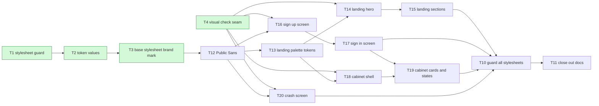

<!-- Copied from be@5663ab6a7e9aeaf70237a282dabec48f2c6b1ca4:docs/features/redesign/tasks/_epic.md by sync-spec. Do not edit here. -->
# Epic — redesign

> **PRD:** [PRD.md](../PRD.md) · **Design:** [sad.md](../sad.md) · **Design spec:** [design-spec.md](../design-spec.md) (Approved 2026-10-29, with the five mockups) · **Data model:** N/A (no data change) · **API:** N/A (no new operation; the existing contract is unchanged) · **ADRs:** [adr/](../adr/)

## Goal

Give the landing page, sign-up, sign-in, the cabinet and the crash screen the look of their references, as drawn in
the approved mockups of the [design spec](../design-spec.md): the landing page always dark in the DarkSaaS look with a
violet accent; sign-up, sign-in, the cabinet and the crash screen in the Mantis look, following the device's light or
dark setting; one brand mark and one token file across all of them; no behaviour change (PRD §1, §2). Delivery is one
pull request per task, the shared design values first, and each screen is approved by the owner from screenshots
(ADR-0003).

## Scope

- **In:** the frontend repository `1_mvp_pilot_fe` only: `tokens.css` (the `.palette-landing` block, gradient and new
  role tokens, ADR-0005), Public Sans (ADR-0006), `base.css`, `BrandMark`, the markup and stylesheets of the five
  screens, the new landing sections and approved wording (design spec §11), the stylesheet guard and the end-to-end
  visual checks. This repository holds the documents.
- **Out (PRD §3, design spec §12):** new features or controls, copied template code, fonts, images or icons, paid
  assets, a component library, backend, API or analytics changes, a theme switch.

## Task map

Parallel branches: after T12 (Public Sans), the landing branch (T13 → T14 → T15), the auth branch (T16 → T17) and the
crash screen (T20) can run side by side; the cabinet shell (T18) needs only T13 and T4. T19 waits for T17 because the
project form shares `AuthForm.css`; T20 and T16 both touch `base.css`, and every screen task that adds its stylesheet
to `GUARDED` in `tests/stylesheets.test.ts` is serialised with the others by its `files_hint` overlap. T10 starts once
the last task of each screen (T15, T17, T19, T20) has merged.

## Tasks

See [tracker.md](./tracker.md) for status. Machine contract: [tasks.json](./tasks.json).

| # | Task | Layer | Blocked by | DoD (short) |
|---|---|---|---|---|
| [T1](./t1-stylesheet-guard.md) | Add the stylesheet guard for design values and motion, starting with App.css | tests | — | `tests/stylesheets.test.ts` fails first (RED commit) because the scanner and the real `App.css` scan fail, then passes (GREEN commit) |
| [T2](./t2-token-values.md) | Rewrite the design token values in place from the Mantis palette and type scale, both themes | ui | T1 | The contrast test (RED first: new pairs and updated names) passes for every new pair in the light and the dark theme |
| [T3](./t3-base-stylesheet-brand-mark.md) | Add base.css (page shell, header, controls, focus ring, alerts) and the shared BrandMark | ui | T2 | `tests/stylesheets.test.ts` with `base.css` guarded fails first, then passes |
| [T4](./t4-visual-check-seam.md) | Add the end-to-end visual-check helpers: width, theme, focus, reduced motion, third-party requests and cabinet stubs | tests | — | Helpers fail first (RED commit), then the helper spec passes against the landing page at `E2E_BASE_URL` |
| [T12](./t12-public-sans.md) | Self-host Public Sans as the body face | ui | T3 | `tests/design-tokens.test.ts` fails first (RED commit) on the missing package, import and token value, then passes |
| [T13](./t13-landing-palette-tokens.md) | Add the landing palette block, the gradient tokens and the new role tokens with their contrast pairs | ui | T12 | The contrast test fails first (RED commit) on the missing block and pairs, then passes for every pair in every palette and theme it applies to |
| [T14](./t14-landing-hero.md) | Landing page, part 1: always-dark palette hook, header and the hero with the decorative preview | ui | T4, T13 | `Landing.css` guarded: RED first, then green with 0 raw values and 0 unguarded motion |
| [T15](./t15-landing-sections.md) | Landing page, part 2: feature cards, "How it works" steps, the final call-to-action card and the footer | ui | T14 | The new text and section assertions fail first (RED commit), then pass; existing behaviour assertions pass unchanged |
| [T16](./t16-sign-up-screen.md) | Sign-up in the Mantis auth layout: brand, centred card with the switch link in its head, divider and fields | ui | T4, T12 | `AuthForm.css` guarded: RED first, then green |
| [T17](./t17-sign-in-screen.md) | Sign-in in the Mantis auth layout with the wrong-credentials alert | ui | T16 | `SignIn.test.tsx` passes with behaviour assertions unchanged: the wrong-credentials message shows and the visitor stays (AC-06), correct credentials reach the cabinet (AC-05) |
| [T18](./t18-cabinet-shell.md) | Cabinet, part 1: Mantis shell with the 280 px sidebar, the top bar with the search and the phone drawer | ui | T4, T13 | `Dashboard.css` guarded: RED first, then green |
| [T19](./t19-cabinet-cards-states.md) | Cabinet, part 2: filter card, project cards with status chips, and every state (loading, empty, first task, no match, failure, delete refused) | ui | T17, T18 | `Dashboard.test.tsx` passes with behaviour assertions unchanged: create, rename, delete an empty project, add task, change status, filter and sign out keep their results (AC-07); a project with tasks is kept with its readable explanation (AC-08); failure, loading, empty and first-task states render (AC-10) |
| [T20](./t20-crash-screen.md) | Crash screen with the brand, a drawn illustration and the message in the display face | ui | T4, T12 | `ErrorFallback.test.tsx` fails first, then passes; the alert's accessible text is the same as before for both variants |
| [T10](./t10-guard-all-stylesheets.md) | Guard every stylesheet and check the brand mark and widths across all screens | tests | T15, T17, T19, T20 | The all-stylesheets scan is green on `develop` with every screen merged, and a deliberately added raw colour in a scratch stylesheet makes it fail (checked locally, not committed) |
| [T11](./t11-close-out-docs.md) | Refresh the frontend architecture map and record the screen approvals | docs | T10 | `docs/architecture-map.md` in the frontend names `src/styles/base.css`, `src/routes/BrandMark.tsx`, the `.palette-landing` block, Public Sans and `tests/stylesheets.test.ts`, and its `reflects_commit` is current |

## Replaced tasks (breakdown of 2026-10-29)

T5 to T9 were written for the narrow "layout rhythm only" scope; their implementation was rejected by the owner and
never merged. Their files are removed and their ids are not reused.

| Old task | Old card | Replaced by |
|---|---|---|
| T5 Restyle the landing page | PILOT-381 | T13 (palette tokens), T14 (hero), T15 (sections) |
| T6 Restyle sign-up | PILOT-382 | T16 (T12 carries Public Sans for every screen) |
| T7 Restyle sign-in | PILOT-383 | T17 |
| T8 Restyle the cabinet | PILOT-384 | T18 (shell), T19 (cards and states), split per the ADR-0003 amendment |
| T9 Restyle the crash screen | PILOT-385 | T20 |

T10 (PILOT-386) and T11 (PILOT-387) keep their ids, titles and cards; their deps and DoD now name the new tasks.

## Assumptions (routine decisions taken in this breakdown)

- B-1: New ids T12 to T20 instead of reusing T5 to T9, so an old card can never be mistaken for a new task.
- B-2: Public Sans did not ride along with T3 (fe #77), so it is its own small task (T12) before any screen, as
  ADR-0006 allows; its screenshots cover every screen once.
- B-3: The landing palette, gradients and the new role tokens (`--color-status-*-soft`, `--color-scrim`) and their
  contrast pairs land in one token task (T13) without the hook class, so no screen changes visually; the landing task
  applies the hook. This keeps the landing pull requests under 500 lines.
- B-4: The landing page is two tasks (hero, then sections); the owner approves the landing page on T15. The cabinet is
  two tasks per the ADR-0003 amendment; the owner approves the cabinet on T19.
- B-5: Shared control variants the auth mockups need (button sizes, the info alert) are added to `base.css` in T16,
  the first screen that uses them; the crash screen's few rules also go to `base.css` (it has no stylesheet, sad §5).
- B-6: The design spec's reference-page question (PRD §8, sad §11 "before T5") is resolved by the approved mockups;
  "T5" there now means T14.

## Risks / Hard rules

- Visual-value assertions are updated openly and listed in each PR; behaviour assertions are never touched (PRD §1, QG-1).
- 0 component libraries, 0 paid assets, 0 template code; the only new dependency is `@fontsource-variable/public-sans`
  (ADR-0006); every illustration is inline SVG drawn in our code (PRD §6, sad §11).
- Each task is at most one day and 500 changed lines; T14, T18 and T19 are the ones to watch, and each names how to
  split it if it grows.
- `AuthForm.css` also styles the cabinet's project form and alerts, so T16 screenshots the cabinet form too.
- The first commit of every non-exempt PR is a failing `test(...)` (TDD check); T11 is docs and exempt.
