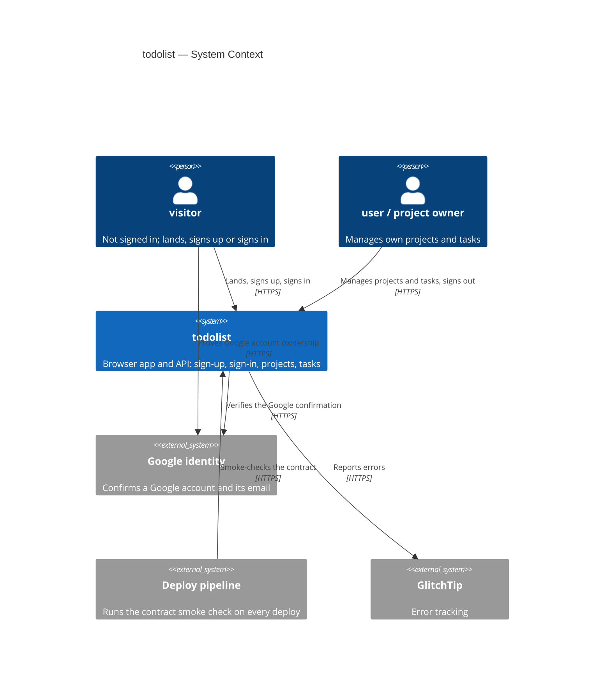
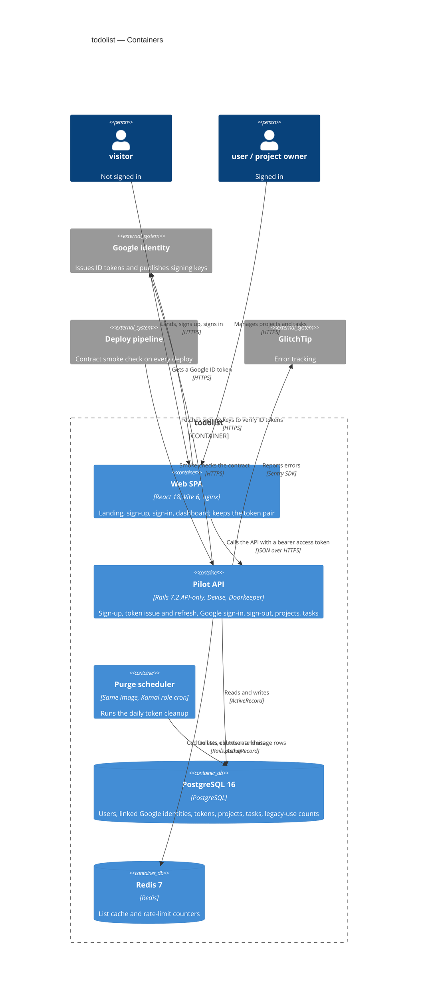
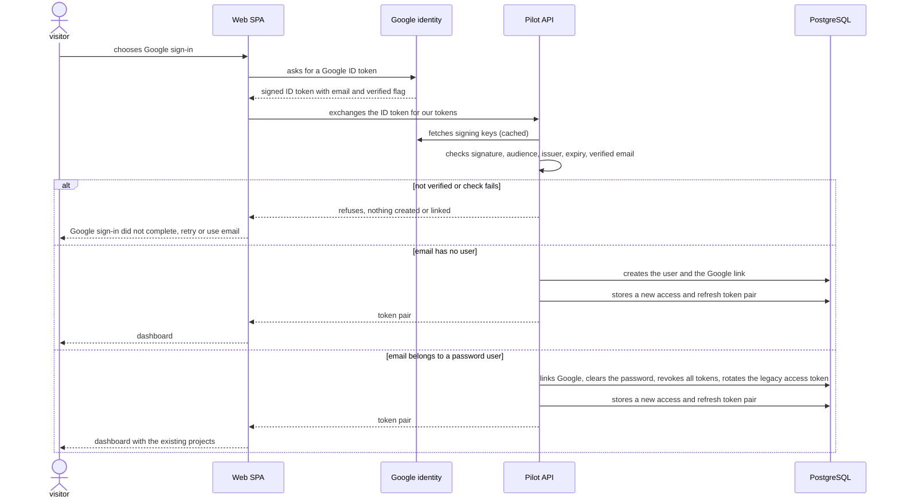
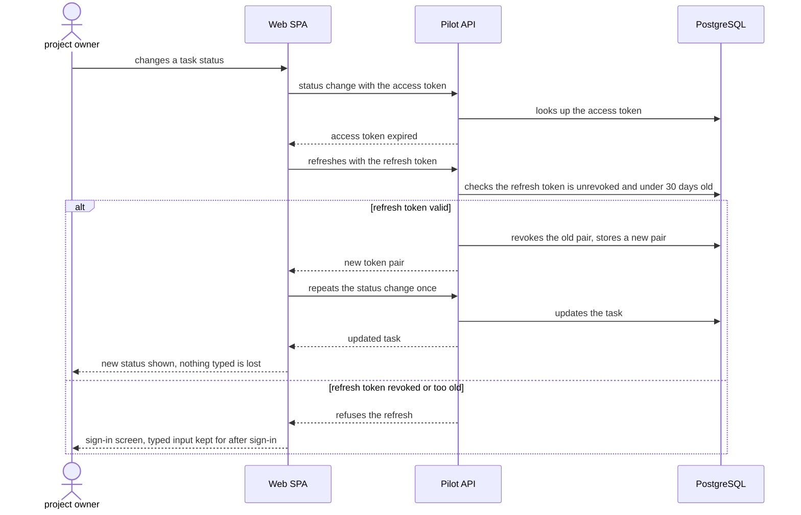
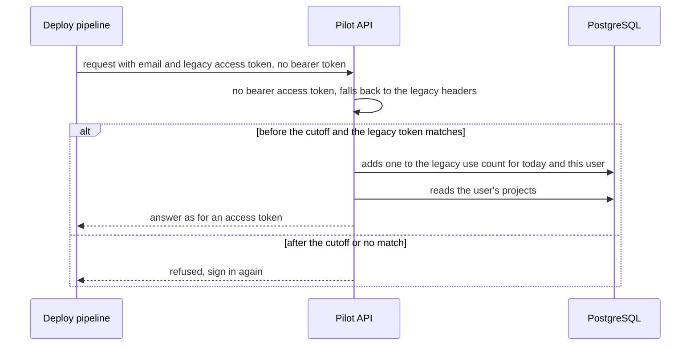

<!-- Copied from be@f8d0b86d06ead4db12af522fa3497992646bd2d0:docs/features/todolist/sad.md by sync-spec. Do not edit here. -->

# Software Architecture Document — todolist

<!-- Stages 04-05 → see sdlc/plugin/skills/architecture-design/SKILL.md -->
<!-- 12 Arc42 sections. Empty sections — <!-- N/A: <one-line reason> -->. -->
<!-- C4 Context (L1) lives inline in §3. C4 Container (L2) lives inline in §5. -->
<!-- §6 Runtime view seeds the primary flow(s) here; complete-sequence-diagrams (stage 06) then -->
<!--    fills §6 with every critical flow / §5 AC — no cap. -->
<!-- Numbers in §10 come VERBATIM from PRD §6 NFR — no inventing, no rounding. -->

## 1. Introduction and goals

**Intent.** Open the existing project and task backend to the public (PRD §2): a visitor lands on a page, signs up with
Google sign-in or with email and password, and is guided through the dashboard to a first completed task. Behind that,
every sign-in gives the device its own revocable access token, and the legacy access token is retired once there is
evidence that nothing uses it any more.

**Quality goals (1-liners; full scenarios in §10):**

1. **QG-1 Account safety** — no account takeover through sign-up, Google sign-in linking or a stolen device token;
   password guessing capped at 10 failed sign-ins per minute per source.
2. **QG-2 No lockout during the switch** — no existing user or deploy check loses access while the legacy access
   token and the new access tokens are accepted side by side.
3. **QG-3 Responsiveness of the core journey** — sign-in p95 ≤ 800 ms; dashboard list and task status change
   p95 ≤ 300 ms.
4. **QG-4 Availability** — 99.5 % per month (PRD §6), kept by the existing health check and deploy path.

**Stakeholders.**

| Role | Interest | Sign-off owner? |
|---|---|---|
| visitor | Landing page, sign-up with Google sign-in or email and password | No |
| user / project owner | Own projects and tasks, sign-in, sign-out | No |
| Operator (runs deploys and `bin/swagger_smoke`) | Deploy checks keep passing through the switch | No |
| Frontend owner (`1_mvp_pilot_fe`) | New landing, sign-in and dashboard screens against the contract | No |
| Security Lead | Authentication change: ADR and regression test (CLAUDE.md Hard Rules) | Yes |
| Tech Lead (OlegShevtsov1) | SAD approval | Yes |

<!-- Decision overrides (¶4) — populated by the Step-7 critic resolution loop, empty otherwise. -->

## 2. Constraints

**Technical.**
- Backend: Ruby 3.3.6, Rails 7.2.3 API-only (`ActionController::API`), Puma — `docs/architecture-map.md` §Stack.
- Devise 5.0.4 for accounts and password hashing; `simple_token_authentication` 1.18 provides today's legacy access
  token (`X-User-Email` + `X-User-Token`, `app/services/base_application/authenticate.rb:18`) — to be retired by this
  feature.
- CanCanCan 3.6 (`Ability`), active_model_serializers 0.10, rswag (contract `swagger/v1/swagger.json`).
- PostgreSQL 16 (`users`, `projects`, `tasks`); Redis 7 as Rails cache and as the store of the existing rate limit
  (`app/controllers/errors_controller.rb:20`).
- Frontend (`1_mvp_pilot_fe`): React 18, Vite 6, TypeScript ~5.6, served by nginx with a runtime `/config.js`; no
  router, no state or data-fetching library, no design system or tokens, no browser storage in use
  (`1_mvp_pilot_fe/docs/architecture-map.md`).

**Organisational.**
- About 2 person-weeks of backend work for one person, after the PRD §3 scope cuts (idea-brief §15, PRD §8).
- Frontend work lands in `1_mvp_pilot_fe` through its own pull requests, against this repo's contract.
- No external deadline.

**Conventions.**
- `CLAUDE.md` and `.claude/rules/` (git, testing, security, API).
- Controller → service (`ApplicationService`, `success?` / `errors` / `status_error`) → serializer; errors through
  `ApiExceptionHandler` and `Authorization` (`docs/architecture-map.md` §Conventions).
- Integer (bigint) primary keys, `add_foreign_key`; migrations append-only, staged under
  `docs/features/todolist/migrations/` first, expand → backfill → contract.
- Each task is `test(...)` (RED) → `feat(...)`/`fix(...)` (GREEN) → optional `refactor(...)`; a new gem needs a reason
  in the pull request.

**Regulatory / external.**
- Public repository: no secrets, internal hostnames, IP addresses or account ids; the Google client id is public
  configuration supplied through the environment.
- Personal data: email (existing) and the identifier of the linked Google account (new) — PRD §6.1.
- PRD §6.1 security review is required. Authentication changes need an ADR and a regression test; any change of an
  operation's status or required input in the public contract needs an ADR (CLAUDE.md Hard Rules).
- Brownfield fact: the frontend has no sign-in yet and has never sent the legacy access token. Today its only users
  are `bin/swagger_smoke` (every dev and prod deploy), the request specs (`spec/support/auth_helper.rb`) and manual
  API callers. The PRD's "frontend has switched" condition is therefore met by the smoke script and the contract
  moving to access tokens.

## 3. Context and scope

The todolist system lets a visitor become a user, either through Google sign-in or with email and password, and lets
a project owner manage their own projects and tasks from a dashboard in the browser (PRD §1). Google is the only new
external dependency: it confirms that a person owns a Google account and its email, and the system trusts nothing else
from it. The trust boundary is the system edge — every request carries an access token (or, until the cutoff, the
legacy access token) that the backend checks; nothing from the browser or from Google is taken without verification.

**External systems (in / out):**

| Actor or system | Type | Interaction |
|---|---|---|
| visitor | Person | Opens the landing page, signs up or signs in |
| user / project owner | Person | Manages own projects and tasks, signs out |
| Google identity | System (external) | Confirms a Google account and its email during Google sign-in (AC-05–AC-07) |
| Deploy pipeline (`bin/swagger_smoke`) | System (internal) | Calls the API on every dev and prod deploy; today with the legacy access token, moved to access tokens by this feature (a legacy pass remains until then, not counted as legacy use) |
| GlitchTip | System (external) | Receives this system's errors and the frontend's relayed error reports |

**C4 Context (L1):**



## 4. Solution strategy

**Target surface(s) (the first decision — what's being built):** `[backend-service, web-frontend]` — the API in this
repository, and the landing, sign-in and dashboard screens in `1_mvp_pilot_fe` (ADR-0001).

**Top strategic choices (the seeds for ADRs):**

1. **Two surfaces: backend API plus web SPA** (ADR-0001) — the journey KPI (PRD §7) and AC-01 / AC-21 live in the
   browser, the rules (AC-02–AC-20, AC-22) in the API; both are designed here so the contract and the screens agree.
   Serves QG-2 and QG-3.
2. **UI-architecture: client-side SPA inside the existing React/Vite app** (ADR-0002) — client-side routing for
   landing, sign-in and dashboard; nginx already falls back to `index.html`, so no new runtime or deploy shape. The UI
   has no design system to reuse (`1_mvp_pilot_fe` §Frontend / UI foundation): this feature introduces its first shared
   CSS tokens file and components, in plain CSS like the existing code.
3. **Opaque, revocable access tokens issued by Doorkeeper on top of Devise** (ADR-0003) — every sign-in creates its own
   token rows, stored hashed; sign-out revokes the device's rows, Google sign-in linking revokes all rows of the user
   (AC-06, AC-11). Serves QG-1.
4. **Google sign-in as ID-token exchange** (ADR-0004) — the browser obtains a Google ID token and the backend verifies
   its signature, audience and verified-email flag before linking or creating the user and issuing tokens through the
   same token endpoint. No server-side redirect, cookie session or client secret. Serves QG-1 (AC-06, AC-07).
5. **Dual scheme with a daily legacy count, then contract** (ADR-0005) — every request checks a bearer access token
   first and falls back to the legacy access token headers, counting each legacy use per day; a later release removes
   the fallback once no legacy use has been seen for 7 days. Serves QG-2 (AC-12, AC-13, KPI legacy retirement).
6. **One-hour access token plus a rotating refresh token that dies after 30 idle days, both kept in localStorage**
   (ADR-0006) — gives PRD §6 "valid until sign-out, or until 30 days pass without use" without a write on every
   request; the script-theft risk of localStorage is reduced by a strict Content-Security-Policy, no third-party
   scripts and text-only rendering. Serves QG-1 and QG-3.

Each tactical decision in later sections should be traceable to one of these strategic seeds. Tactical decisions that
*contradict* a strategic choice are red flags — surface them in §11 Risks.

## 5. Building block view

Both containers keep their repository's existing style. The API stays layered — controller → service → serializer,
authorization through `Ability`, errors through `ApiExceptionHandler` (`docs/architecture-map.md` §Conventions) — and
gains one new module, `auth`, that owns token issue, Google sign-in linking, sign-out and the legacy fallback; the
existing `users`, `sessions`, `projects` and `tasks` modules are extended, not replaced. The SPA keeps the frontend's
"explicit imports, props down, plain CSS" style and adds routing, an API client that attaches and refreshes tokens, and
the first shared CSS tokens file.

**Internal decomposition:**

```
1_mvp_pilot_be (backend-service)
app/controllers/api/v1/
├── base_controller.rb          dual-scheme authentication: bearer access token, then legacy headers (ADR-0005)
├── tokens_controller.rb        NEW sign-out (revoke this device's tokens); token issue is Doorkeeper's endpoint
├── users_controller.rb         sign-up now also issues tokens (AC-02)
├── sessions_controller.rb      legacy sign-in kept until the cutoff (ADR-0005)
├── projects_controller.rb      unchanged rules; another user's project answered as not found (AC-17)
└── tasks_controller.rb         same as projects
app/services/auth/              NEW module
├── google_sign_in.rb           verify the Google ID token, then create or link the user (ADR-0004, AC-05–AC-07)
├── link_identity.rb            link + cancel password, all tokens and the legacy access token (AC-06)
├── issue_tokens.rb             one access + refresh token pair per sign-in (ADR-0003, ADR-0006)
├── revoke_device.rb            sign-out; on a legacy device rotates the legacy access token (AC-11, AC-11b)
└── legacy_usage.rb             daily count of legacy access token use (ADR-0005, PRD §6)
config/deploy*.yml              NEW Kamal role cron: daily token cleanup (sad.md §7)
config/initializers/doorkeeper.rb  NEW password grant, Google assertion grant, refresh rotation, 30-day idle rule
app/models/                     user (Devise + Doorkeeper owner), new identity and legacy-use records (data model stage)

1_mvp_pilot_fe (web-frontend)
src/
├── routes/                     Landing, SignUp, SignIn, Dashboard (+ guided empty state) — ADR-0002
├── api/client.ts               fetch wrapper: attaches the access token, refreshes once on expiry, retries
├── auth/tokenStore.ts          the token pair in localStorage (ADR-0006)
└── styles/tokens.css           first shared design tokens (colours, spacing, type)
```

**C4 Container (L2):**



## 6. Runtime view

architecture-design seeds the primary flows here; `complete-sequence-diagrams` then covers every PRD §5 acceptance
criterion. Participants are the §5 containers.

**Critical flow 1: Google sign-in, new user or linking (AC-05, AC-06, AC-07)**



**Critical flow 2: expired access token while working (ADR-0006, PRD §6 token lifetime)**



**Critical flow 3: dual-scheme request during the transition (ADR-0005, AC-12, AC-13)**



## 7. Deployment view

Both containers keep their existing Kamal 2 deployment units unchanged in shape: one API container and one nginx
frontend container per environment behind kamal-proxy with TLS, dev deployed on every `develop` commit that passed CI,
prod only through `Kamal Deploy` with a typed confirm (README, `config/deploy.yml`). The feature adds configuration,
one scheduled task and new migrations, not new containers.

**Deployment changes:**
- **Configuration:** `GOOGLE_CLIENT_ID` (public) in the API environment and in the frontend's runtime `/config.js`
  (through the existing safe-character check of `docker/40-config-js.sh`); rack-cors allows the `Authorization`
  header; no client secret is needed (ADR-0004).
- **Content-Security-Policy:** the frontend's nginx sends a strict policy — scripts only from the app's own origin and
  Google's sign-in script, no inline script, frames only from Google, connections only to the API and Google. This is
  the precondition of ADR-0006.
- **Client address behind kamal-proxy:** the sign-in and sign-up rate limits key on the client address, so the API
  must read the real client address from the proxy's forwarded header and trust only kamal-proxy; a request spec pins
  it.
- **Scheduled purge:** a second Kamal role, `cron`, runs the same image with a small scheduler loop that calls the
  token cleanup task once a day — revoked and expired token rows older than 30 days, legacy-use rows older than 60
  days. The existing deploy has only the `web` role and no background jobs, so this adds one container per
  environment (shown in §5); the other containers are unchanged.
- **Migrations:** staged under `docs/features/todolist/migrations/` and promoted by the implementing tasks,
  expand → backfill → contract; the contract step (removing the legacy access token) is a separate release
  (ADR-0005).

**Monitoring:**
- Refused requests and failed sign-ins per hour, compared over the 24 hours after each deploy with the previous 7
  days (PRD §6 "existing users locked out: 0").
- Daily legacy access token use from its table — the cutoff evidence (PRD §6, §7).
- Sign-in, dashboard list and task status change p95 from server request timing, reviewed weekly (PRD §6).
- GlitchTip alert when the daily purge task fails or does not run.

**Scaling thresholds:**
- Token rows: about 500 users × 2 active devices × 8 refreshes a day ≈ 8 000 rows a day, about 240 000 kept at the
  30-day purge horizon — comfortable for one indexed table on the existing database.
- Legacy-use rows: at most one per user per day; a few hundred rows in total at pilot scale.
- Revisit purge frequency and token indexing above 5 000 users (ten times the PRD's Reach assumption).

## 8. Crosscutting concepts

The default is the repository's conventions (`CLAUDE.md`, `docs/architecture-map.md` §Conventions); the rows below
record them and this feature's overrides.

| Concept | Convention | Where defined |
|---|---|---|
| Authentication | Bearer access token first, then the legacy `X-User-Email` / `X-User-Token` headers until the cutoff, each legacy use counted per day per user | ADR-0003, ADR-0005; `Api::V1::BaseController` |
| Token lifetime | One-hour access token; rotating refresh token refused once it is 30 days old; sign-out revokes the device's pair | ADR-0006 |
| Authorization | `Ability` unchanged as a second line; project and task lookups scoped to the signed-in user, so other users' items are not found (AC-17) | ADR-0007 |
| Error handling | `ApiExceptionHandler` / `{ errors: [...] }` with `status_error` as today; the token endpoint answers in the standard OAuth error shape | `docs/architecture-map.md` §Conventions; contracts stage |
| Rate limiting | Existing `RateLimitStore` on Redis: failed sign-ins counted per source, refused above 10 per minute before the password is checked; sign-ups refused above 5 per hour per source (AC-04b, AC-10) | here; precedent `app/controllers/errors_controller.rb:20` |
| Email matching | Devise lowercases and strips emails (`config/initializers/devise.rb:61`, `:66`); the email from a Google ID token goes through the same normalisation (AC-06) | here |
| Secrets in logs and reports | `filter_parameters` already masks every key containing `token` (access, refresh, ID token) and `passw`; the `Authorization` header is also removed from GlitchTip events | `config/initializers/filter_parameter_logging.rb`; here |
| Browser token safety | Token pair in localStorage only; strict Content-Security-Policy, no third-party scripts, user text always rendered as text | ADR-0006; §7 |
| ID strategy | Integer (bigint) primary keys, `add_foreign_key` | `docs/architecture-map.md` §Conventions |
| Caching | Per-user project and task list cache unchanged; token lookups not cached in v1 | `app/services/projects/index.rb:26` |
| Internationalisation | N/A — English only | — |
| Observability | Sentry SDK to GlitchTip as today; request timing for the PRD §6 p95 targets | `config/initializers/sentry.rb` |

## 9. Architecture decisions

| # | Title | Status | Section |
|---|---|---|---|
| 0001 | Build todolist as a backend API plus a web SPA | Accepted | §4 |
| 0002 | Deliver the screens as a client-side SPA inside the existing React app | Accepted | §4 |
| 0003 | Issue revocable opaque access tokens with Doorkeeper | Accepted | §4 |
| 0004 | Exchange a verified Google ID token for our access token | Accepted | §4 |
| 0005 | Accept the legacy headers alongside bearer tokens until the evidence cutoff | Accepted | §4 |
| 0006 | Use a one-hour access token with a rotating refresh token that dies after 30 idle days | Accepted | §4 |
| 0007 | Scope project and task lookups to the owner, so other users' items are not found | Accepted | §8 |
| 0008 | Sign-up returns the legacy fields only while no web client is configured | Accepted | §5 |

ADR files live under `docs/features/todolist/adr/NNNN-<title>.md`.

## 10. Quality requirements

Each quality goal from §1 expanded into a testable scenario; numbers are PRD §6 verbatim.

**QG-1. Account safety**
- **When:** an 11th failed sign-in arrives from one source within a minute, or a 6th sign-up within an hour; Google
  sign-in completes for the email of an existing password user; a device refreshes with a refresh token that is
  30 days old; a user asks for another user's project or task.
- **Then:** the sign-in or sign-up is refused ("≤ 10 failed sign-ins per minute per source; ≤ 5 sign-ups per hour per
  source"); after linking, the password, every access and refresh token and the legacy access token of that user stop
  working (AC-06); the refresh is refused ("Valid until sign-out, or until 30 days pass without use"); the other
  user's item is answered as not found (AC-17).
- **How verify:** request specs for the sign-in and sign-up limits, for Google linking (the authentication regression
  test required by CLAUDE.md, with a stubbed Google key set), for refresh-token age and rotation, and for owner-scoped
  lookups; `bundle exec brakeman --no-pager -q` in CI; Security Lead review of ADR-0003–ADR-0007.

**QG-2. No lockout during the switch**
- **When:** any dev or prod deploy while the legacy access token and access tokens are both accepted.
- **Then:** "Existing users locked out by the sign-in change: 0"; legacy access token use is "Counted daily, history
  kept ≥ 30 days".
- **How verify:** `bin/swagger_smoke` runs its authenticated checks with a bearer access token on every dev and prod
  deploy, and with the legacy headers only until the smoke script itself has been switched; that legacy pass is marked
  as a pipeline call and is not counted as legacy use, so the 7-day rule measures real callers; refused requests and
  failed sign-ins in the 24 hours after each deploy compared with the previous 7 days; the legacy-use table read
  before the cutoff decision (ADR-0005).

**QG-3. Responsiveness of the core journey**
- **When:** a user signs in, opens the dashboard, or changes a task status.
- **Then:** "Sign-in time p95, our part (email and password, or completing Google sign-in) ≤ 800 ms";
  "Dashboard list p95, for a user with up to 50 projects and 500 tasks ≤ 300 ms"; "Task status change p95 ≤ 300 ms".
- **How verify:** server request timing reviewed weekly; before release, a seeded run against dev with one user
  holding 50 projects and 500 tasks, reading the p95 of 100 dashboard list and 100 status change requests.

**QG-4. Availability**
- **When:** any calendar month after launch.
- **Then:** "99.5 % per month".
- **How verify:** health check uptime, monthly.

## 11. Risks and technical debt

| Risk / debt | Severity | Mitigation | Owner |
|---|---|---|---|
| A script running on the page reads the token pair from localStorage (PRD §6.1 stolen-token abuse case) | Medium | Strict Content-Security-Policy from the frontend's nginx, no third-party scripts, user text always rendered as text; access token lives one hour (ADR-0006, §7) | Frontend owner |
| A lost device cannot be signed out from another device (accepted in PRD §6.1) | Medium | Google sign-in revokes all of the user's access; "sign out everywhere" is the first cut feature to return after launch (PRD §8) | OlegShevtsov1 |
| Wrong client address behind kamal-proxy makes all visitors share one rate limit, or lets one bypass it | Medium | Read the forwarded client address only from kamal-proxy; a request spec pins it (§7) | Backend |
| `devise_for :users` mounts Devise's default routes whose behaviour in API-only mode is unknown (`config/routes.rb:8`, architecture map) | Medium | The first auth task lists the mounted routes and keeps only those the feature needs, with a routing spec | Backend |
| `ApplicationController#authenticate_user!` is an empty override, so a controller not inheriting `Api::V1::BaseController` is public (`app/controllers/application_controller.rb:4`) | Medium | New controllers inherit `Api::V1::BaseController`; only Doorkeeper's token endpoint, sign-up and (until the cutoff) the legacy sign-in are public, each with a spec, and the failed-sign-in counter covers the legacy sign-in too | Backend |
| The token endpoint and the AC-17 "not found" answer change the public contract and could break `bin/swagger_smoke` or the frontend | Medium | rswag specs, `swagger/v1/swagger.json` and `bin/swagger_smoke` updated in the same release; frontend built against the regenerated contract (ADR-0007) | Backend |
| Seven ADRs of work against about two person-weeks of backend budget | Medium | The `break-tasks` estimate decides; PRD §8 owner decides on cuts | OlegShevtsov1 |
| A wrong or lost legacy-use count leads to a premature cutoff | Low | Count kept in a database table (§5); the cutoff is a manual release decision that reads the table (ADR-0005) | OlegShevtsov1 |
| A Google outage or failed key fetch blocks Google sign-in | Low | Signing keys cached; email and password sign-in keeps working; GlitchTip alert on verification errors | Backend |
| The daily purge stops and the token tables grow | Low | GlitchTip alert when the purge task fails or does not run (§7) | Backend |
| Open architectural decision: who runs the first moderated session of 5 people (KPI time to first completed task) | Open question | Resolve before `/sdlc-ship-feature`; PRD §8 default: the owner, before launch | OlegShevtsov1 |
| Open architectural decision: real expected sign-up figure (marketing plan or audience) | Open question | Resolve before `/sdlc-ship-feature`; PRD §8 default: 500 per quarter | OlegShevtsov1 |
| Open architectural decision: which cut feature returns first after launch (default: signing out other devices) | Open question | Resolve after launch review; PRD §8 | OlegShevtsov1 |
| Open architectural decision: does the cut scope fit two weeks of backend work | Open question | Resolve at `/sdlc-break-tasks`; PRD §8 and idea-brief §12 Time | OlegShevtsov1 |


Resolved at this stage:
- PRD §8 "Relax the project description rule?" — kept at 20–120 characters, no contract change (decided 2026-10-22).
- PRD §8 "What event marks 'the frontend has switched'?" — the frontend never used the legacy access token, so the
  cutoff trigger is: `bin/swagger_smoke` and the contract use access tokens, and no real legacy use was seen for 7 days
  (decided 2026-10-22; overrides the PRD default "that frontend release"; ADR-0005).

**Accepted debt (acceptable in v1, plan to fix later):**
- Two authentication paths until the contract release removes the legacy access token (ADR-0005).
- Token lookups are not cached in v1; revisit if QG-3 sign-in or list p95 drifts.
- No "sign out everywhere" (PRD §3).

## 12. Glossary

Domain terms are canonical in the repository's `CONTEXT.md`; this table repeats those used here and adds the
technical terms this SAD introduces.

| Term | Meaning |
|---|---|
| visitor | A person using the app who is not signed in (CONTEXT.md) |
| user | A person identified by a unique email who owns projects (CONTEXT.md) |
| project owner | The user who created a project; the only one who can see, change or delete it and its tasks (CONTEXT.md) |
| access token | The secret a device receives at sign-in and presents on every request; revocable on its own (CONTEXT.md). Here: Doorkeeper-issued, valid one hour (ADR-0003, ADR-0006) |
| legacy access token | The single never-expiring secret each user has from before Google sign-in, sent with the email; accepted until the cutoff (CONTEXT.md, ADR-0005) |
| Google sign-in | Signing in by proving ownership of a Google account; links to an existing user of the same email and cancels their password and all existing access (CONTEXT.md, ADR-0004) |
| sign-in / sign-out | Exchanging email and password for an access token / ending the current device's access (CONTEXT.md) |
| refresh token | Technical: a second secret issued with each access token, used once to get a new pair; refused once it is 30 days old (ADR-0006) |
| Google ID token | Technical: Google's signed statement naming the account and its email, verified by the API before Google sign-in completes (ADR-0004) |
| cutoff | The release that stops accepting the legacy access token, once the smoke check and contract use access tokens and no legacy use was seen for 7 days (ADR-0005) |
| Content-Security-Policy | Technical: the browser rule, sent by the frontend's nginx, that limits which scripts and connections the page may use (§7, ADR-0006) |
